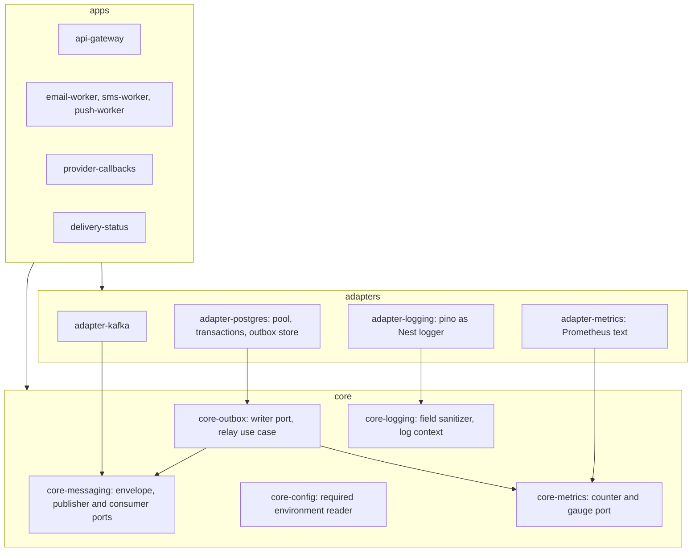
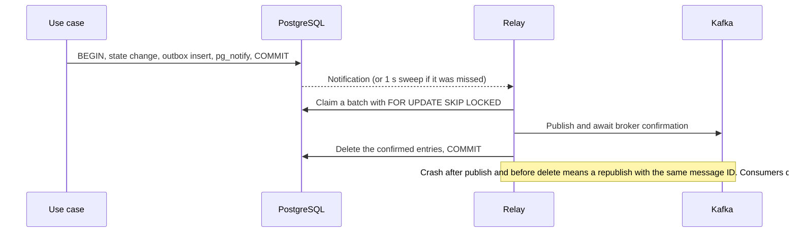

# Platform Foundation Design

**Spec**: `.specs/features/platform-foundation/spec.md`
**Status**: Approved (owner, 2026-11-04)

Canonical architecture: [HLD](../../../docs/architecture/notification-service/high-level-design.md) §4.2 (layering), §4.4 (broker), §4.5 (persistence), §5.1 (outbox), §9 (observability); [ADR-0001](../../../docs/architecture/notification-service/decisions/0001-structure-platform-as-choreographed-pipeline-with-ports-and-adapters.md), [ADR-0002](../../../docs/architecture/notification-service/decisions/0002-accept-notifications-durably-with-outboxes-and-at-least-once-hops.md), [ADR-0010](../../../docs/architecture/notification-service/decisions/0010-use-a-database-per-application-on-shared-postgresql.md). This document covers only what this feature builds.

---

## Architecture Overview

A Nest CLI monorepo with six applications and two kinds of library. `core-*` libraries hold ports and rules and import no technology. `adapter-*` libraries implement those ports. An oxlint rule enforces the split.



The outbox path:



**FC-31 review:** this feature adds no cross-application coordination and no orchestrator.

---

## Code Reuse Analysis

### Existing Components to Leverage

| Component | Location | How to Use |
| --------- | -------- | ---------- |
| Bootstrap and module shape | `src/main.ts`, `src/app.module.ts` | Move to `apps/api-gateway/src/`; remove the Observe wiring |
| E2E test pattern | `test/app.e2e-spec.ts` | Same `Test.createTestingModule` and supertest pattern for each app's liveness test |
| Path alias handling | `jest.config.ts` | Already reads tsconfig `paths`, so `nest g library` aliases work with no change |
| Coverage globs | `jest.config.ts` | Already lists `apps/**` and `libs/**` |
| Lint setup | `.oxlintrc.json` | Add the path-scoped `no-restricted-imports` override. Verified on 2026-11-04 with the installed oxlint: flags a `pg` import under `libs/core-*`, not under `libs/adapter-*` |

### Integration Points

| System | Integration Method |
| ------ | ------------------ |
| Later features | Import `core-*` ports, and wire `adapter-*` modules at each app's root module |
| PostgreSQL | One database and user per application (D-45), migrations per application |
| Kafka | Topic names are not defined here; they arrive with each feature's event contract |

---

## Components

### Applications

- **Purpose**: One deployable per confirmed responsibility.
- **Location**: `apps/api-gateway`, `apps/email-worker`, `apps/sms-worker`, `apps/push-worker`, `apps/provider-callbacks`, `apps/delivery-status`
- **Interfaces**: `GET /health/live` returns 200. Each reads a `PORT`.
- **Dependencies**: `core-config`, `adapter-logging`.
- **Reuses**: The starter's bootstrap. The starter's `Hello World` route and its two tests are replaced by the liveness route and its tests, because FND-02 replaces that behaviour.

### core-config

- **Purpose**: Read required environment values or fail clearly.
- **Location**: `libs/core-config/`
- **Interfaces**:
  - `readConfig(spec, env): Config`: throws `MissingConfigError` listing variable names only.
- **Dependencies**: none.
- **Reuses**: none.

### core-logging

- **Purpose**: Decide what may be logged, independent of the logging library.
- **Location**: `libs/core-logging/`
- **Interfaces**:
  - `sanitize(fields): SafeFields`: replaces classified keys with `[REDACTED]`, and replaces nested objects under unclassified keys with `[DROPPED]` (FND-07, FND-26).
  - `runWithLogContext(ids, fn)`, `currentLogContext(): LogIds`: `AsyncLocalStorage` for notification, tenant and integration IDs (FND-08).
- **Dependencies**: none.
- **Reuses**: none.

### adapter-logging

- **Purpose**: Implement Nest's `LoggerService` on pino, sending every entry through `sanitize`.
- **Location**: `libs/adapter-logging/`
- **Interfaces**: `PlatformLogger implements LoggerService`.
- **Dependencies**: `pino`, `core-logging`.
- **Reuses**: Nest's `LoggerService` contract.

### core-metrics and adapter-metrics

- **Purpose**: Collect measures from day one (D-34) without choosing a backend.
- **Location**: `libs/core-metrics/`, `libs/adapter-metrics/`
- **Interfaces**:
  - `Metrics.increment(name, labels)`, `Metrics.gauge(name, value, labels)`
  - `emitAlert(logger, metrics, name, ids)`: the structured log event plus counter that the spec defines as an alert.
  - `GET /metrics` in Prometheus text format.
- **Dependencies**: `prom-client` in the adapter only.
- **Reuses**: none.

### core-messaging

- **Purpose**: Define what the platform needs from a broker (§4.4), with no Kafka types.
- **Location**: `libs/core-messaging/`
- **Interfaces**:
  - `MessagePublisher.publish(message: OutboundMessage): Promise<void>`: resolves only after broker confirmation.
  - `MessageConsumer.subscribe(topic, handler: MessageHandler): Promise<void>`, `stop(): Promise<void>`
  - `MessageHandler.handle(envelope): Promise<void>`: a throw means redeliver.
  - `MessageHandler.unprocessable(meta, reason): Promise<void>`: called for a bad version or shape (FND-14). Its completion commits the message.
- **Guarantee stated by the port**: at-least-once, commit after handler completion, no ordering promise (D-49, D-61).
- **Dependencies**: none.
- **Reuses**: none.

### adapter-kafka

- **Purpose**: Implement the broker port.
- **Location**: `libs/adapter-kafka/`
- **Interfaces**: `KafkaPublisher implements MessagePublisher`, `KafkaConsumer implements MessageConsumer`.
- **Dependencies**: `@confluentinc/kafka-javascript`.
- **Reuses**: none. Auto-commit is off and each message commits after its handler resolves. Message metadata travels in record headers.

### core-outbox

- **Purpose**: Hold the outbox write port and the relay use case.
- **Location**: `libs/core-outbox/`
- **Interfaces**:
  - `TransactionRunner.run<T>(work: (tx: TransactionContext) => Promise<T>): Promise<T>`: `TransactionContext` is opaque to use cases.
  - `OutboxWriter.append(tx, message): Promise<void>`
  - `OutboxStore.claimBatch(limit, publishAll): Promise<number>`, `OutboxStore.stats(): Promise<OutboxStats>`
  - `OutboxRelay.start()`, `stop()`, `drain()`
- **Dependencies**: `core-messaging`, `core-metrics`.
- **Reuses**: none.

### adapter-postgres

- **Purpose**: Own the connection pool, transactions, the outbox store, and the outbox migration.
- **Location**: `libs/adapter-postgres/`
- **Interfaces**: `PostgresTransactionRunner`, `PostgresOutboxStore implements OutboxWriter, OutboxStore`, `outboxMigration`.
- **Dependencies**: `pg`, `kysely`, `node-pg-migrate`.
- **Reuses**: none.

### Local infrastructure

- **Purpose**: Start the dependencies with one command, with database isolation built in.
- **Location**: `infra/local/compose.yaml`, `infra/local/postgres-init.sh`, `.env.example`
- **Interfaces**: `bun run infra:up`, `bun run infra:down`.
- **Dependencies**: Docker, in the WSL distro.
- **Reuses**: none. Compose reads credentials from a gitignored `.env`, and `.env.example` holds names only.

### Check command

- **Purpose**: One command for the gates marked CI (FND-24).
- **Location**: `package.json` script `check`.
- **Interfaces**: `bun run check`.
- **Dependencies**: Existing scripts.
- **Reuses**: `lint`, `test`, `build`.

---

## Data Models

### Outbox entry

One table per owning database (API / Gateway, three workers, callbacks), from the shared migration.

```typescript
interface OutboxEntry {
  id: string          // the message identity; survives republish (FND-13)
  topic: string
  messageKey: string
  headers: Record<string, string>
  payload: Buffer     // already encrypted where the contract requires it (D-63)
  createdAt: Date
}
```

**Relationships**: none; the entry is deleted once the broker confirms it (FND-19).

### Message envelope

```typescript
interface MessageEnvelope<T> {
  messageId: string
  type: string
  contractVersion: number
  occurredAt: string
  traceContext?: string
  payload: T
}
```

---

## Error Handling Strategy

| Error Scenario | Handling | User Impact |
| -------------- | -------- | ----------- |
| Missing configuration | Non-zero exit listing variable names | Deployment fails clearly at start-up |
| Handler throws | No commit; message is redelivered | Delay only |
| Bad contract version or shape | `unprocessable`, then commit | Later features turn this into a DLQ entry and `FAILED` |
| Broker down during relay | Entries stay; relay retries with capped delay | Backlog gauge rises; nothing is lost |
| Crash between publish and delete | Republish with the same message ID | Consumers dedupe |
| Transaction rollback | Neither state nor outbox entry persists | Caller sees the failure |

---

## Risks & Concerns

| Concern | Location (file:line) | Impact | Mitigation |
| ------- | -------------------- | ------ | ---------- |
| Security: placeholder credentials and third-party telemetry in source | `src/app.module.ts:13` | Conflicts with C-09 and HLD §8 (I-09) | T2 removes the module and dependencies |
| Tech debt: package name matches no application | `package.json:2` | Confusing artifacts (I-08) | T1 renames it to `notification-service` |
| Tech debt: starter `deploy` script | `package.json:8` | Unapproved deploy path | T2 removes it (FND-04) |
| Fragile: scaffold is untracked in git | `package.json`, `src/`, `test/` | Later diffs have no baseline | T1 commits the unchanged scaffold first; `.agents`, `.claude`, `.cursor` and `.github` stay out of feature commits for the owner to decide |
| Test gap: `lint` covers only `src/` and `test/` | `package.json:14` | The dependency rule would not run on `apps/` and `libs/` | T1 widens the script |
| Install risk: the Confluent client is native, and `bun` blocks lifecycle scripts unless trusted | `package.json` | Client could install without its binary | T14 adds it to `trustedDependencies`, and its integration test proves it loads |
| Uncertain: exact redelivery behaviour of `@confluentinc/kafka-javascript` after a thrown handler | `libs/adapter-kafka/` | FND-11 could need explicit seek logic | T15's integration test decides this before anything depends on it; read the client's documentation first |
| Environment: Docker unavailable in this WSL distro | Local machine | Full gates cannot run | Owner enables WSL integration before Phase 3; Phases 1 and 2 do not need it |
| Bug: `PORT` is not validated (found 2026-11-06 by starting the built apps; Jira key pending, to be created in Sprint 0) | `libs/core-config/src/config.ts:20`, `apps/*/src/main.ts:8` | A non-numeric `PORT` (`abc`, `3000abc`) or `-1` or `0` does not fail: Node treats the string as a Unix socket path, so the app stays up, listens on no TCP port and leaves a socket file named after the value in the working directory. `PORT=99999` logs "started", then crashes with a raw `RangeError` stack trace. FND-03 covers only a missing value, so this is outside the approved requirement and no test fails | Validate `PORT` as an integer from 1 to 65535 in `core-config` and fail naming the variable, never the value, as the missing case does; add unit and e2e tests. Needs an owner decision on requirement wording before it is built |
| Scale: outbox polling load | `libs/adapter-postgres/` | Sweeps add database load | Notify-driven wake-up with a 1 s sweep; deleting published entries keeps the table small |

---

## Tech Decisions (only non-obvious ones)

| Decision | Choice | Rationale |
| -------- | ------ | --------- |
| Monorepo tool | Nest CLI (owner-confirmed approach) | Already configured, with no new tool |
| Kafka client | `@confluentinc/kafka-javascript`, used directly | Explicit commits. `@nestjs/microservices` relies on `kafkajs`, last published in 2023 |
| Database access | `pg` with Kysely queries, `node-pg-migrate` | Explicit SQL semantics for `SKIP LOCKED` and conditional updates; typed without an ORM's entity layer crossing the ports |
| Library naming | `core-*` and `adapter-*` | `nest g library` makes flat directories, and the lint glob needs a predictable path |
| Dependency rule tool | oxlint `no-restricted-imports` with overrides | Already installed and verified; no new tool |
| Outbox wake-up | `pg_notify` plus a 1 s sweep | Meets FND-17 without CDC infrastructure; §5.6 left this open |
| Metrics format | Prometheus text behind a port | Vendor-neutral and easy to replace; no backend is chosen (I-09) |
| Test tiers | `*.spec.ts`, `*.integration-spec.ts`, `*.e2e-spec.ts` | The current regex matches `.spec.ts` only, so tiers stay separate with no change to `jest.config.ts` |

No project-level `AD-NNN` entry: these choices are reversible behind ports, or are covered by D-54.
