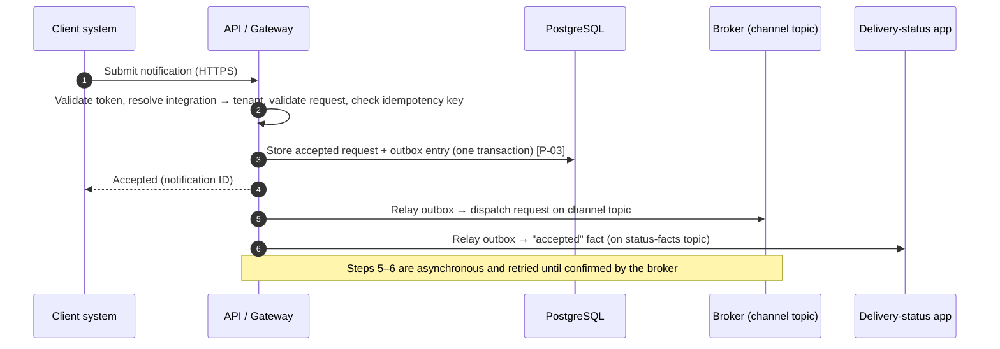
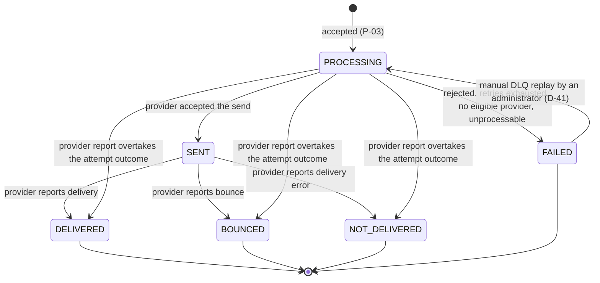

# Notification Platform — High-Level Design

> **Status:** Draft for review, revision 31 (2026-11-02): ADR-0001 to ADR-0013 accepted; D-68 and D-69. Revision 30: consistency clean-up after the ADR review; D-66 and D-67; OQ-51 to OQ-58; FC-32 and FC-33 (Proposed). Revision 29 added ADR links in §2.3 and §13 and fitness-check IDs in §14. Nothing in this document is approved unless it is labelled **Confirmed**. Confirmed decisions are listed in the [decision log](#23-decision-log).
> **Inputs:** [`CLAUDE.md`](../../../CLAUDE.md), [`architecture-context.md`](architecture-context.md), [`diagrams/notification-platform-hld.drawio`](diagrams/notification-platform-hld.drawio) (initial proposal), repository state as of 2026-10-22, project-owner decisions of 2026-10-22.
> **Decision owner:** The project owner approves architecture decisions (**Confirmed**, 2026-10-22).

## 0. How to read this document

Every material statement carries one of these labels:

| Label | Meaning |
|---|---|
| **Confirmed** | Supplied by the project owner in `CLAUDE.md`, `architecture-context.md`, or the [decision log](#23-decision-log). |
| **Diagram** | Shown in the initial Draw.io diagram. The diagram is itself an *initial proposal*, so these elements are not approved; they are the starting point this HLD explains or questions. |
| **Proposed** | A recommendation from this HLD, awaiting review. |
| **Assumption** | Something this HLD has to presume to keep reasoning; it must be validated. |
| **Open question** | Information needed before a design choice can be made. Listed in [§11](#11-open-questions). |
| **Rejected** | An option considered and not recommended, with the reason. |

Identifiers: constraints `C-nn`, proposals `P-nn`, assumptions `A-nn`, open questions `OQ-nn`, quality scenarios `QS-nn`, inconsistencies `I-nn`. Inconsistencies found during analysis are listed in [§12](#12-inconsistencies-and-missing-information).

---

## 1. Purpose and scope

### 1.1 Purpose

**Confirmed.** A multi-channel notification platform that lets client systems send SMS, email, and push notifications. It is built as a NestJS monorepo with six planned applications, uses Apache Kafka as its initial broker and PostgreSQL as its initial database, and must be able to route a client's notifications to a provider selected for that client.

### 1.2 In scope for this HLD

- Responsibilities and boundaries of the six applications.
- Main runtime flows: submission, dispatch, provider callback, status maintenance, and the important failure paths.
- Abstraction boundaries for the broker, the providers, and persistence, plus what portability actually costs.
- Who owns notification data and delivery status.
- Reliability, security, privacy, observability, and operational concerns.
- Trade-offs, risks, open questions, and decisions that need approval.

### 1.3 Explicit non-goals of this HLD

- No class designs, payload schemas, topic/queue naming conventions, table schemas, or endpoint definitions. These belong in the follow-up artifacts listed in [§13](#13-follow-up-artifacts).
- No provider selection and no provider-specific API design (**Confirmed**: no provider has been selected).
- No deployment topology, SLO, capacity, or compliance targets (**Confirmed**: not established).
- No implementation plan or task breakdown.

### 1.4 Out of scope until requirements say otherwise

**Confirmed (D-48):** only single notifications are in scope for now. Templates, scheduled sends, recipient preferences/opt-out, and bulk sends are **future scope**. The design should not rule them out, but nothing is built for them now.

The following capabilities are *not* assumed. They are listed so that their absence is visible rather than silent. (Status reads by integrations were on this list until D-16 confirmed them.) notification templates/content rendering, scheduled or delayed sends, recipient preference/opt-out management, automatic provider failover, weighted or cost-based routing, and bulk/campaign sends. Each one appears as an open question where it affects the design.

**Confirmed non-goal (D-21):** the platform does not push status to integrations through outbound webhooks or callbacks. Integrations retrieve status from the platform through its API.

---

## 2. Architectural drivers

### 2.1 Confirmed constraints

| ID | Constraint | Source |
|---|---|---|
| C-01 | NestJS monorepo, initially six applications. | `CLAUDE.md`, context §1–2 |
| C-02 | Kafka is the initial broker. RabbitMQ or AWS SQS adapters must be feasible without rewriting notification business rules. Zero-cost substitution is **not** promised. | context §3, §4.1 |
| C-03 | PostgreSQL is the initial database. Alternative SQL or NoSQL stores (including MongoDB) must be evaluable. Zero-cost substitution is **not** promised. | context §3, §4.3 |
| C-04 | No providers have been selected. Providers must be addable and replaceable without scattering vendor logic. | context §4.2 |
| C-05 | Provider routing must be able to select a provider based on the client/customer. Failover, fallback, weighted, cost-based, and availability-based routing are **not** assumed. The base policy is now defined by C-12 and C-13. | context §4.2 |
| C-06 | Abstractions must be built around needed capabilities, not hypothetical ones. | context §4.4 |
| C-07 | There must be exactly one source of truth for delivery status, with ownership and transition rules defined before implementation. | `CLAUDE.md` |
| C-08 | Submission, dispatch, callbacks, and status updates must be treated as potentially duplicated or out of order. | `CLAUDE.md` |
| C-09 | Sensitive payloads, credentials, and unnecessary personal data must not appear in logs, traces, or metrics. | `CLAUDE.md` |
| C-10 | The project owner is the architecture decision owner and approver. | Decision log D-01 |
| C-11 | OpenID Connect (OIDC) for user identity, OAuth 2.0 for delegated access and service-to-service access, NestJS guards for enforcement. Deferred until an IdP exists (D-47); integrations use API keys now. | Decision log D-02 |
| C-12 | Once the client is identified, routing selects the provider configured for that client, stored in the platform database. | Decision log D-03 |
| C-13 | If the client has no configured provider, a default provider is used. The default provider is not yet defined. | Decision log D-03 |
| C-14 | Provider credentials are owned by the platform only. Clients hold credentials to access the platform and nothing else. | Decision log D-04 |
| C-15 | One OAuth client per independently managed customer integration. The platform backend controls the integration-to-tenant mapping. Scopes are least-privilege. Tenant identifiers supplied by callers are never trusted. | Decision log D-05 |
| C-16 | Routing configuration is managed through administrative endpoints, so that a back-office can be built on them later. | Decision log D-06 |
| C-17 | When a send fails, it is retried with exponential backoff up to 3 times before the notification fails for good. | Decision log D-07 |
| C-18 | An integration can see only the notifications it submitted itself, never those of other integrations, even in the same tenant. | Decision log D-08 |
| C-19 | Provider configuration is per tenant. | Decision log D-09 |
| C-20 | At most 4 attempts in total (the original plus 3 retries). Backoff base 1 s, cap 30 s. Permanent rejections are not retried. Timeout handling is not yet defined. | Decision log D-10 |
| C-21 | A failure that a provider reports after accepting a send is final. It never triggers a resend. | Decision log D-11 |
| C-22 | Administrative traffic is separated from integration traffic. There is one administrator role for now. | Decision log D-12 |
| C-23 | The platform does not distinguish frontend from backend callers. Every integration is treated as a backend service, that is, a caller that can keep a secret (a confidential OAuth client in the deferred target design, D-47). | Decision log D-13, narrowed and clarified by D-14 |
| C-24 | Retry delay before retry *n* (*n* = 1 for the first retry) is d<sub>n</sub> = min(cap, base × 2<sup>n−1</sup>), with base = 1 s and cap = 30 s. | Decision log D-15 |
| C-25 | Integrations can read the status of the notifications they submitted, and only those (with C-18). | Decision log D-16 |
| C-26 | Equal jitter is applied to the D-15 retry delays: actual delay = d<sub>n</sub>/2 + random in [0, d<sub>n</sub>/2]. | Decision log D-17, D-18 |
| C-27 | Status must become visible and be read as fast as possible. A "not found" answer for a notification that was just submitted is acceptable. | Decision log D-19 |
| C-28 | Status updates come from providers in provider-specific ways. A dedicated application receives them and publishes them to a Kafka topic. The delivery-status app (status projector) consumes that topic and updates status. | Decision log D-20 |
| C-29 | Integrations obtain status by calling the platform's API. The platform never pushes status to integrations. | Decision log D-21 |
| C-30 | Status is received from each provider through the push mechanism that provider offers: webhook or queue. Whatever a provider supports is implemented, even if it is only one of the two. Polling is not used now. | Decision log D-22, narrowed by D-23 and D-24 |
| C-31 | When a provider reports no further outcome, `SENT` ("accepted by provider") is the final known status. A future feature will update such states by polling providers. | Decision log D-24, D-25 |
| C-32 | Status vocabulary: `PROCESSING`, `SENT`, `DELIVERED`, `BOUNCED`, `NOT DELIVERED` (§6.3). | Decision log D-26 |
| C-33 | Acceptance uses a transactional outbox (P-03). | Decision log D-27 |
| C-34 | Integrations authenticate with OAuth 2.0 client credentials or API keys (this extends C-11 for integrations). The tenant comes only from credentials verified by the backend. The maximum revocation propagation time is explicit. Access tokens are short-lived. OAuth part deferred (D-47). | Decision log D-28 (initial direction) |
| C-35 | `FAILED` (with a status reason) covers every failure before the provider accepted the notification. `NOT DELIVERED` is used only when the provider reports a delivery failure. | Decision log D-29 |
| C-36 | When final statuses conflict, the first final status wins, for now. | Decision log D-30 |
| C-37 | Each integration has exactly one credential type, OAuth client credentials or an API key, chosen by an administrator at creation. All integrations currently use API keys (D-47). | Decision log D-31 |
| C-38 | Revocation takes effect within 5 minutes at most: revocation in the integration registry, a registry cache of 60 s or less, and JWT access tokens lasting 5 minutes. The JWT part applies once an IdP exists (D-47). | Decision log D-32 |
| C-39 | PostgreSQL, written only by the Delivery-status app, is the system of record for delivery status. Event topics are inputs with operational retention. | Decision log D-33 |
| C-40 | Numeric quality targets are deferred, but every measure is collected from day one. | Decision log D-34 |
| C-41 | Every submission carries an idempotency key, scoped per integration, remembered for 24 hours. A retry returns the original notification. | Decision log D-35 |
| C-42 | Rate limits per integration, with values set by an administrator. | Decision log D-36 |
| C-43 | Each of the six applications has its own deployment. The outbox pattern runs in the API / Gateway and the provider-callbacks app (D-37), and in the three workers (D-61). | Decision log D-37 |
| C-44 | Content and recipients: 30 days, then deleted or anonymized. Status history: 1 year. Topics and DLQ: no longer than 30 days. LGPD recommendations apply. | Decision log D-38 |
| C-45 | No maximum notification age. Manual DLQ replay by administrators, keeping the original notification ID. Alert on DLQ growth. | Decision log D-39 |
| C-46 | Alert when a notification stays in `PROCESSING` for more than 5 minutes. | Decision log D-40 |
| C-47 | A manual DLQ replay may reopen `FAILED` to `PROCESSING`. This is the only exception to C-36. | Decision log D-41 |
| C-48 | Provider configuration is per channel, with at most one configured provider per tenant per channel, and one platform-wide default per channel. | Decision log D-42 |
| C-49 | A submission is rejected only after the platform has tried to find a valid provider (tenant configuration, then default) and found none. | Decision log D-43 |
| C-50 | Routing configuration can be served from a Redis cache; how fast changes take effect does not matter. | Decision log D-44 |
| C-51 | One shared PostgreSQL instance with a separate database per application. | Decision log D-45 |
| C-52 | Infrastructure credentials are secrets provided through environment variables, set up later. | Decision log D-46 |
| C-53 | No identity provider for now: integrations authenticate with platform-issued API keys. | Decision log D-47 |
| C-54 | Only single notifications for now. Templates, scheduling, preferences/opt-out, and bulk sends are future scope. | Decision log D-48 |
| C-55 | No ordering requirement across notifications; delivery order may differ from submission order. | Decision log D-49 |
| C-56 | No delegated access (acting on behalf of a person) for now. | Decision log D-50 |
| C-57 | "API key" and "token" mean the same thing: one platform-issued secret per integration, sent in a request header. | Decision log D-51 |
| C-58 | Administrators authenticate with administrator API keys, valid only on the administrative surface. | Decision log D-52 |
| C-59 | Internal service-to-service calls authenticate with a service key per calling application (environment-variable secret) plus a network restriction. | Decision log D-53 |
| C-60 | Business rules and use cases depend only on narrow ports built around needed capabilities. Broker, database, cache, and provider technologies live only in adapters. | Decision log D-54 |
| C-61 | The worker resolves the provider at send time through a separate routing policy. Retries keep the first attempt's provider. Attempt outcomes record the provider used and whether it came from tenant configuration or the default. | Decision log D-55 |
| C-62 | Status reads go through the Delivery-status app's internal query interface, scoped by tenant and integration. A foreign notification is indistinguishable from an unknown one. | Decision log D-56 |
| C-63 | Choreographed, event-driven pipeline: each stage reacts to facts published by the previous one, with no central orchestrator. | Decision log D-57 |
| C-64 | Application responsibilities as listed in §5.1, §5.2, and §5.4. This includes: idempotency-key conflicts are rejected; worker outcomes are classified as accepted, permanent, retryable, or unknown; the three workers share one dispatch use case but deploy separately; workers throttle to each provider account's rate limit. | Decision log D-58 |
| C-65 | Data ownership per §4.5 and §6.1. Workers keep an attempt ledger that is not delivery status. Accepted requests are immutable. Sensitive values live in a secrets store; non-sensitive configuration lives in environment variables. | Decision log D-59 |
| C-66 | Status only moves forward by rank (`PROCESSING` < `SENT` < final statuses), except a manual DLQ replay (D-41). Provider reports may skip `SENT`. The attempt number is an attribute. `FAILED` reasons start as `REJECTED_BY_PROVIDER`, `RETRIES_EXHAUSTED`, `NO_ELIGIBLE_PROVIDER`, `UNPROCESSABLE`. `BOUNCED` and `NOT DELIVERED` may carry a normalized provider reason. | Decision log D-60 |
| C-67 | At-least-once delivery between applications; exactly-once delivery to recipients is not promised. Every application that stores state and publishes uses an outbox, including the workers. Provider idempotency keys are used where supported and are a provider-selection criterion. | Decision log D-61 |
| C-68 | LGPD handling per §6.4: status history without personal data; the platform as operator and tenants as controllers; necessity and purpose limitation; tenant-scoped administrative deletion; international transfer as a provider-selection criterion; encryption and an incident path. Subject to legal/DPO review. | Decision log D-62 |
| C-69 | Content and recipient data are encrypted at application level from acceptance until the worker's provider call. | Decision log D-63 |
| C-70 | API keys are generated by the platform and shown once, stored as peppered hashes, sent only in headers, scoped to one integration (or the administrative surface), rotated with an overlap period, and never logged; a non-secret prefix identifies them. | Decision log D-64 |
| C-71 | The fitness checks in §14 (FC-01 to FC-26, D-65; FC-27 to FC-31, D-66; FC-32 and FC-33, D-69; FC-09 as redefined by D-67) are built together with the features they protect. | Decision log D-65, D-66, D-67, D-69 |

### 2.2 Quality characteristics, as scenarios

No quantitative targets have been supplied (**Confirmed** in context §6). The scenarios below define *what must be true*. Their measures stay **TBD**: numeric targets are deferred until real load is known, but every measure is collected from day one (**Confirmed**, D-34). Priority is **Proposed**.

| ID | Characteristic | Stimulus → required response | Measure | Priority |
|---|---|---|---|---|
| QS-01 | Durability of accepted requests | When the API returns success to a client, the request survives the crash of any single platform process. | Zero accepted-but-lost requests in fault-injection tests. | High |
| QS-02 | Status integrity | Duplicate or reordered attempt results and callbacks never move a notification to an earlier or contradictory status. | Property/replay tests over shuffled, duplicated event streams. | High |
| QS-03 | Duplicate-send containment | When a worker crashes or is redelivered a message, the platform does not knowingly send the same notification twice, and the residual duplicate window is documented per provider. | Window documented; duplicate-send rate observable. | High |
| QS-04 | Provider replaceability | Adding a provider for a channel changes only that provider's adapter, its configuration, and routing data. | Code change is confined to the adapter module (dependency rule check). | High |
| QS-05 | Broker replaceability | Introducing a non-Kafka broker adapter does not change domain or use-case code. Any lost semantics are documented. | Dependency rule check; adapter limitation record. | Medium |
| QS-06 | Channel isolation | An outage or slowdown of one channel's provider does not stall the other channels. | Other channels' latency is unaffected in a provider-outage test. | High |
| QS-07 | Inbound status trust | A provider status update that cannot be authenticated for its mechanism, whether an unsigned or replayed webhook, a queue message from an unexpected source, never changes status. | Security tests per provider adapter and mechanism. | High |
| QS-08 | Stuck-work visibility | A notification that has made no progress within a bounded time becomes visible to operators. | **Confirmed (D-40):** alert after 5 minutes in `PROCESSING` (FC-09, D-67). | Medium |
| QS-09 | Client fairness | One client's burst does not starve other clients, or exhaust a shared platform-owned provider quota, beyond an agreed bound. **Confirmed (D-36):** rate limits per integration from the start, with values set by an administrator. Because of C-14, all clients routed to a provider share the platform's account with it. | Numeric bound deferred until real load is known (D-34). | Open → raised to Medium by C-14 |
| QS-10 | Tenant and integration isolation | A request authenticated as integration *X* of tenant *A*, whether by its own token or a delegated token, can never submit as, read, or influence tenant *B*'s notifications, status, or routing. It also cannot read notifications submitted by tenant *A*'s other integrations (C-18). | Authorization tests per endpoint. The tenant is derived only from the backend's integration → tenant mapping (C-15). | High |
| ~~QS-12~~ | ~~Abuse containment for frontend integrations~~ | Retired by D-14: the platform does not design for the caller's nature. The remaining abuse risk, a leaked integration credential, is covered in §8.1. | — | Retired |
| QS-11 | Credential confinement | Provider credentials are never returned to clients, published on the broker, logged, or readable by an application that does not call that provider or verify its callbacks. | Secrets access audit; log scanning; grant review. | High |

QS-04 and QS-05 pull against simplicity (C-06), and QS-03 pulls against throughput. These tensions are discussed in [§10](#10-trade-offs).

### 2.3 Decision log

Confirmed by the project owner on 2026-10-22: D-01 to D-04 during review of revision 1, D-05 to D-07 during review of revision 2, D-08 to D-13 during review of revision 3, D-14 and D-15 during review of revision 4, D-16 and D-17 (and the clarification of D-14) during review of revision 5, D-18 to D-20 during review of revision 6, D-21 and D-22 during review of revision 7, D-23 to D-25 during review of revision 8, D-26 to D-28 during review of revision 9, D-29 and D-30 during review of revision 10, D-31 and D-32 during review of revision 11, D-33 during review of revision 12, D-34 to D-40 during review of revision 13, D-41 to D-48 during review of revision 14, D-49 and D-50 during review of revision 15, D-51 to D-53 during review of revision 16, D-54 to D-56 during review of revision 17, D-57 to D-65 during the item-by-item review of revision 18. D-66 to D-69 were confirmed on 2026-11-02, during the review of the ADRs; the owner accepted ADR-0001 to ADR-0013 the same day. Timeouts (OQ-16) were explicitly deferred by the owner. Each decision is recorded in exactly one ADR, linked in the ADR column; the convention is in [`decisions/README.md`](decisions/README.md) (Confirmed 2026-10-27).

| ID | Decision | Resolves | New questions it raises | ADR |
|---|---|---|---|---|
| D-01 | The project owner approves architecture decisions. | OQ-01 | — | [ADR-0012](decisions/0012-govern-architecture-through-owner-approval-and-fitness-checks.md) |
| D-02 | Identity and access: OIDC for user identity, OAuth 2.0 for delegated and service-to-service access, enforcement in NestJS guards. | OQ-03 (mechanism) | OQ-20, OQ-21, OQ-22, OQ-25, OQ-26 | [ADR-0008](decisions/0008-authenticate-callers-with-api-keys-and-defer-oidc-oauth.md) |
| D-03 | Routing uses the provider configured for the client in the database. If none is configured, a default provider is used; the default is still to be defined. | OQ-06 (location), OQ-07 | OQ-22, OQ-24, OQ-27, OQ-28 | [ADR-0003](decisions/0003-route-tenant-notifications-to-configured-or-default-provider.md) |
| D-04 | Provider credentials are platform-owned only. Clients' credentials grant access to the platform only. | OQ-06 (credential ownership) | OQ-23 | [ADR-0003](decisions/0003-route-tenant-notifications-to-configured-or-default-provider.md) |
| D-05 | One OAuth client per independently managed customer integration. The backend controls the client-to-tenant mapping. Scopes are least-privilege. This keeps credential identity separate from customer data isolation, and the platform never trusts tenant identifiers supplied by callers. | OQ-21 | OQ-29, OQ-30 | [ADR-0009](decisions/0009-isolate-tenants-and-integrations-and-separate-admin-traffic.md) |
| D-06 | Administrative endpoints manage routing configuration, to support a future back-office. | OQ-22 | OQ-33 | [ADR-0003](decisions/0003-route-tenant-notifications-to-configured-or-default-provider.md) |
| D-07 | After a failed send, retry with exponential backoff up to 3 times; then the notification fails for good. | OQ-24; OQ-17 (count and backoff shape) | OQ-31, OQ-32 | [ADR-0004](decisions/0004-retry-failed-sends-with-capped-backoff-and-manual-dlq-replay.md) |
| D-08 | An integration cannot see notifications submitted by other integrations, even in the same tenant. | OQ-29 | — | [ADR-0009](decisions/0009-isolate-tenants-and-integrations-and-separate-admin-traffic.md) |
| D-09 | Provider configuration is per tenant. | OQ-30; confirms A-04; I-17 | — | [ADR-0003](decisions/0003-route-tenant-notifications-to-configured-or-default-provider.md) |
| D-10 | 4 attempts in total (original plus 3 retries). Backoff base 1 s, cap 30 s. Permanent rejections are not retried. Timeouts are yet to be defined. | OQ-31 (except timeouts) | OQ-16 (still open) | [ADR-0004](decisions/0004-retry-failed-sends-with-capped-backoff-and-manual-dlq-replay.md) |
| D-11 | Provider-reported failures after acceptance do not trigger resends. | OQ-32 | — | [ADR-0004](decisions/0004-retry-failed-sends-with-capped-backoff-and-manual-dlq-replay.md) |
| D-12 | Administrative traffic is separated from integration traffic. One administrator role for now. | OQ-33 | — | [ADR-0009](decisions/0009-isolate-tenants-and-integrations-and-separate-admin-traffic.md) |
| D-13 | Integrations include both frontend applications and backend services. It must not be assumed that only administrators are human users of the API. **Narrowed by D-14.** | Corrects revision 3's resolution of I-16 | Narrowed by D-14 | [ADR-0009](decisions/0009-isolate-tenants-and-integrations-and-separate-admin-traffic.md) |
| D-14 | Treat every connection as coming from a backend service. The platform does not need to care whether the client is a backend or a frontend. **Clarified in the revision 5 review:** "we just send notifications" refers to the platform's role. It does not exclude status reads (D-16). | OQ-34, OQ-35, OQ-36 (not applicable); I-19 | — | [ADR-0009](decisions/0009-isolate-tenants-and-integrations-and-separate-admin-traffic.md) |
| D-15 | Backoff formula: d<sub>n</sub> = min(cap, base × 2<sup>n−1</sup>), *n* = 1 for the first retry, base 1 s, cap 30 s. The retry window this gives is intended. | OQ-37; confirms the doubling multiplier (A-06) | OQ-39 | [ADR-0004](decisions/0004-retry-failed-sends-with-capped-backoff-and-manual-dlq-replay.md) |
| D-16 | Integrations can read the status of the notifications they submitted, and only those (with D-08). | OQ-38; the pull part of OQ-05 | OQ-41 | [ADR-0006](decisions/0006-keep-delivery-status-in-postgresql-and-expose-it-by-api-pull.md) |
| D-17 | Add jitter to the retry delays. | OQ-39 | OQ-40 (which form of jitter) | [ADR-0004](decisions/0004-retry-failed-sends-with-capped-backoff-and-manual-dlq-replay.md) |
| D-18 | Use equal jitter (P-05). | OQ-40 | — | [ADR-0004](decisions/0004-retry-failed-sends-with-capped-backoff-and-manual-dlq-replay.md) |
| D-19 | Status must be made visible and read as fast as possible. "Not found" right after submission is acceptable. | OQ-41 | OQ-02 (numeric latency target) | [ADR-0006](decisions/0006-keep-delivery-status-in-postgresql-and-expose-it-by-api-pull.md) |
| D-20 | Provider status updates arrive in provider-specific ways. The provider-callbacks application receives them and publishes them to a Kafka topic, from which the status projector updates status. | Confirms the diagram's callback → `provider-events` → `Status Projector` flow; OQ-05 (inbound side) | OQ-42 | [ADR-0007](decisions/0007-ingest-provider-status-by-push-through-callbacks-app.md) |
| D-21 | Integrations retrieve status from the platform through its API. The platform does not push status to them. | A-07; OQ-05 (closed) | — | [ADR-0006](decisions/0006-keep-delivery-status-in-postgresql-and-expose-it-by-api-pull.md) |
| D-22 | Status is received from providers by polling, webhook, or queue, depending on what each provider offers. Whatever a provider supports is implemented, even if it is only one of the three. **Narrowed by D-23 and D-24:** polling is not used now. | OQ-42 (mechanisms); I-20 | OQ-43, OQ-44 | [ADR-0007](decisions/0007-ingest-provider-status-by-push-through-callbacks-app.md) |
| D-23 | Only push mechanisms (webhook or queue). No reconciliation polling. | OQ-43 | — | [ADR-0007](decisions/0007-ingest-provider-status-by-push-through-callbacks-app.md) |
| D-24 | The platform does not poll providers for now; it only sends. Polling is deferred to a future feature that will update states providers did not report. | OQ-44 (not applicable); polling part of OQ-18 | — | [ADR-0007](decisions/0007-ingest-provider-status-by-push-through-callbacks-app.md) |
| D-25 | For outcomes a provider never reports, "accepted by provider" (now `SENT`, D-26) is the final known status, for now. | OQ-15 (that part only) | — | [ADR-0007](decisions/0007-ingest-provider-status-by-push-through-callbacks-app.md) |
| D-26 | Status vocabulary: `PROCESSING` (still processing on the platform's side), `SENT` (sent to the provider), `DELIVERED` (provider reported delivery), `BOUNCED` (provider reported a bounce; probably email, but usable by other channels), `NOT DELIVERED` (provider reported delivery errors). | OQ-15 (vocabulary) | OQ-45, OQ-46 | [ADR-0005](decisions/0005-model-delivery-status-as-forward-only-state-machine.md) |
| D-27 | P-03 approved: durable acceptance via a transactional outbox. | P-03 | OQ-12 (where the relay runs) | [ADR-0002](decisions/0002-accept-notifications-durably-with-outboxes-and-at-least-once-hops.md) |
| D-28 | Integration authentication, initial direction: OAuth 2.0 client credentials **or** API keys, depending on client requirements. Tenant identity is tied to credentials verified in the backend and is never trusted from a `tenantId` sent by the client alone. Maximum revocation propagation time must be defined explicitly, using a common community value. If JWTs are used, evaluate short lifetimes and the cost of revocation checks. | OQ-20 (validation and revocation) | OQ-47, OQ-48; IdP product still open | [ADR-0008](decisions/0008-authenticate-callers-with-api-keys-and-defer-oidc-oauth.md) |
| D-29 | Add a `FAILED` status, with a status reason, for: provider rejecting the send, retries exhausted, no eligible provider, unprocessable message. `NOT DELIVERED` is set only when a provider reports a delivery failure (by webhook or queue). | OQ-45 | Interaction with timeouts (OQ-16) | [ADR-0005](decisions/0005-model-delivery-status-as-forward-only-state-machine.md) |
| D-30 | Conflicting final statuses: first final status wins, for now. | OQ-46 | — | [ADR-0005](decisions/0005-model-delivery-status-as-forward-only-state-machine.md) |
| D-31 | One credential type per integration, chosen by an administrator when the integration is created. Never both. | OQ-47; I-21 | — | [ADR-0008](decisions/0008-authenticate-callers-with-api-keys-and-defer-oidc-oauth.md) |
| D-32 | Revocation proposal accepted: at most 5 minutes; revocation in the registry, a registry cache of 60 s or less, JWT access tokens lasting 5 minutes. | OQ-48 | — | [ADR-0008](decisions/0008-authenticate-callers-with-api-keys-and-defer-oidc-oauth.md) |
| D-33 | PostgreSQL is the source of truth for delivery status (the PostgreSQL row of the §6.2 table). The event log as source of truth is rejected. | §6.2; I-05 | — | [ADR-0006](decisions/0006-keep-delivery-status-in-postgresql-and-expose-it-by-api-pull.md) |
| D-34 | Defer numeric targets until load is known; measure from day one. | OQ-02 | — | [ADR-0012](decisions/0012-govern-architecture-through-owner-approval-and-fitness-checks.md) |
| D-35 | The idempotency key is mandatory on every submission, scoped per integration, remembered for 24 hours. A retry returns the original notification. | OQ-04 | — | [ADR-0002](decisions/0002-accept-notifications-durably-with-outboxes-and-at-least-once-hops.md) |
| D-36 | Rate limits per integration from the start, values set by administrators. | OQ-09 | — | [ADR-0009](decisions/0009-isolate-tenants-and-integrations-and-separate-admin-traffic.md) |
| D-37 | Each application has its own deployment. The outbox runs in the API / Gateway and in the provider-callbacks app. | OQ-12 (deployment and relay) | OQ-12 (database topology) | [ADR-0002](decisions/0002-accept-notifications-durably-with-outboxes-and-at-least-once-hops.md) |
| D-38 | Retention as recommended (30 days for content and recipients, 1 year for status history, topics and DLQ no longer than 30 days), following LGPD recommendations. | OQ-13 | — | [ADR-0011](decisions/0011-protect-personal-data-with-encryption-and-bounded-retention.md) |
| D-39 | No maximum age for now; manual DLQ replay through an admin endpoint, keeping the original notification ID; alert on DLQ growth. | OQ-17 | OQ-49 | [ADR-0004](decisions/0004-retry-failed-sends-with-capped-backoff-and-manual-dlq-replay.md) |
| D-40 | Alert when a notification stays in `PROCESSING` for more than 5 minutes. | OQ-18 | — | [ADR-0004](decisions/0004-retry-failed-sends-with-capped-backoff-and-manual-dlq-replay.md) |
| D-41 | Approve: a manual DLQ replay may reopen `FAILED` to `PROCESSING`, as the only exception to D-30. | OQ-49 | — | [ADR-0005](decisions/0005-model-delivery-status-as-forward-only-state-machine.md) |
| D-42 | A-01 to A-03 confirmed: per-channel configuration, at most one provider per tenant per channel, one platform-wide default per channel. | OQ-28 | — | [ADR-0003](decisions/0003-route-tenant-notifications-to-configured-or-default-provider.md) |
| D-43 | Reject a submission only after trying to find a valid provider for it. | OQ-08 | — | [ADR-0003](decisions/0003-route-tenant-notifications-to-configured-or-default-provider.md) |
| D-44 | How fast routing changes take effect doesn't matter; routing configuration can live in a Redis cache; the database remains its source of truth. | OQ-27 | — | [ADR-0003](decisions/0003-route-tenant-notifications-to-configured-or-default-provider.md) |
| D-45 | One shared PostgreSQL instance with a separate database per application. | OQ-12 (database topology) | — | [ADR-0010](decisions/0010-use-a-database-per-application-on-shared-postgresql.md) |
| D-46 | Kafka, PostgreSQL (and other infrastructure) credentials will be secrets available through environment variables, added later. | OQ-26 (credentials) | — | [ADR-0010](decisions/0010-use-a-database-per-application-on-shared-postgresql.md) |
| D-47 | No identity provider for now; authentication is by API key/token only. Defers the IdP-dependent parts of D-02, D-28, D-31, D-32. | OQ-20 | OQ-50 | [ADR-0008](decisions/0008-authenticate-callers-with-api-keys-and-defer-oidc-oauth.md) |
| D-48 | Only single notifications for now; templates, scheduling, preferences, and bulk sends are future scope. | OQ-19 | — | [ADR-0001](decisions/0001-structure-platform-as-choreographed-pipeline-with-ports-and-adapters.md) |
| D-49 | No ordering requirement across notifications (the common case). | OQ-10 | — | [ADR-0002](decisions/0002-accept-notifications-durably-with-outboxes-and-at-least-once-hops.md) |
| D-50 | Delegated access is not needed for now. | OQ-25 | — | [ADR-0008](decisions/0008-authenticate-callers-with-api-keys-and-defer-oidc-oauth.md) |
| D-51 | "API key/token" means one platform-issued secret per integration, sent in a header. | OQ-50 (1) | — | [ADR-0008](decisions/0008-authenticate-callers-with-api-keys-and-defer-oidc-oauth.md) |
| D-52 | Administrator API keys, valid only on the administrative endpoints, never on integration traffic. (The single role is D-12.) | OQ-50 (2) | — | [ADR-0008](decisions/0008-authenticate-callers-with-api-keys-and-defer-oidc-oauth.md) |
| D-53 | A service key per calling application, injected through environment variables, plus a network restriction, for internal calls such as API → Delivery-status app. | OQ-50 (3) | — | [ADR-0008](decisions/0008-authenticate-callers-with-api-keys-and-defer-oidc-oauth.md) |
| D-54 | P-01 approved: ports around needed capabilities, technologies in adapters, no generic framework. | P-01 | — | [ADR-0001](decisions/0001-structure-platform-as-choreographed-pipeline-with-ports-and-adapters.md) |
| D-55 | P-02 approved: routing policy called by the worker at dispatch (option B), same provider for retries, provider and source recorded per attempt. | P-02 | — | [ADR-0003](decisions/0003-route-tenant-notifications-to-configured-or-default-provider.md) |
| D-56 | P-04 approved: status reads through the Delivery-status app's internal query interface (option A). | P-04 | — | [ADR-0006](decisions/0006-keep-delivery-status-in-postgresql-and-expose-it-by-api-pull.md) |
| D-57 | Choreography approved (§4.1): each application reacts to facts published by the previous one, with no central orchestrator. Stuck-work detection is D-40; end-to-end tracing is Proposed (§9). | §4.1 | — | [ADR-0001](decisions/0001-structure-platform-as-choreographed-pipeline-with-ports-and-adapters.md) |
| D-58 | Application responsibilities approved (§5.1, §5.2, §5.4), including the idempotency conflict rule, the four outcome classes, the shared dispatch use case, and per-provider-account throttling. | §5 responsibility lists | — | [ADR-0001](decisions/0001-structure-platform-as-choreographed-pipeline-with-ports-and-adapters.md) |
| D-59 | Data ownership approved: per-application database contents, the worker attempt ledger, immutable accepted requests. Secrets store for sensitive data only; non-sensitive configuration in environment variables. Clarifies D-46. | §4.5, §6.1, §8.2 | Secrets store product (open) | [ADR-0010](decisions/0010-use-a-database-per-application-on-shared-postgresql.md) |
| D-60 | Status transition rules approved (§6.3): forward-only rank, provider reports may skip `SENT`, attempt number as an attribute, the starting `FAILED` reasons, and normalized provider reasons on `BOUNCED` and `NOT DELIVERED`. | §6.3 | — | [ADR-0005](decisions/0005-model-delivery-status-as-forward-only-state-machine.md) |
| D-61 | Delivery guarantees approved (§7.1, §7.3): at-least-once hops, duplicates minimized not eliminated, provider idempotency keys where supported, and an outbox in each worker. | §7.1, §7.3 | OQ-16 (unknown outcomes) | [ADR-0002](decisions/0002-accept-notifications-durably-with-outboxes-and-at-least-once-hops.md) |
| D-62 | LGPD considerations approved (§6.4): status history without personal data, operator/controller roles, necessity and purpose limitation, tenant-scoped deletion, international transfer as a provider-selection criterion, encryption and an incident path. | §6.4 | Legal/DPO review | [ADR-0011](decisions/0011-protect-personal-data-with-encryption-and-bounded-retention.md) |
| D-63 | Application-level encryption of content and recipients approved. | §6.4 (previously an open option) | Secrets-store / key-management product (open) | [ADR-0011](decisions/0011-protect-personal-data-with-encryption-and-bounded-retention.md) |
| D-64 | API key handling approved (§8.1): generated and shown once, peppered hashes, headers only, scoped, rotated with overlap, never logged, non-secret prefix. | §8.1 | — | [ADR-0008](decisions/0008-authenticate-callers-with-api-keys-and-defer-oidc-oauth.md) |
| D-65 | Fitness checks approved (§14). | §14 | — | [ADR-0012](decisions/0012-govern-architecture-through-owner-approval-and-fitness-checks.md) |
| D-66 | Fitness checks FC-27 to FC-31 approved, to be built together with the features they protect (as D-65). | §14 (rows added in revision 29) | — | [ADR-0012](decisions/0012-govern-architecture-through-owner-approval-and-fitness-checks.md) |
| D-67 | FC-09 is redefined around D-40: a notification that stays in `PROCESSING` for more than 5 minutes must raise an alert. A notification at `SENT` with no further provider report is not stuck (D-25) and raises no alert. | FC-09 conflict with D-25 | — | [ADR-0004](decisions/0004-retry-failed-sends-with-capped-backoff-and-manual-dlq-replay.md) |
| D-68 | Correlation race handled as in ADR-0013: unmatched provider events are parked durably by the Delivery-status app, applied when the attempt outcome establishes the correlation, and alerted on (without a status change) if still unmatched after a bounded period. | §5.3 correlation race; I-07 | OQ-57, OQ-58 | [ADR-0013](decisions/0013-correlate-early-provider-reports-with-attempt-outcomes.md) |
| D-69 | Fitness checks FC-32 and FC-33 approved, to be built together with the features they protect (as D-65, D-66). | §14 (rows added in revision 30) | — | [ADR-0012](decisions/0012-govern-architecture-through-owner-approval-and-fitness-checks.md) (amendment) |

### 2.4 Terms

D-05 separates two ideas that revision 2 called "client":

| Term | Meaning | Status |
|---|---|---|
| **Tenant** | A customer of the platform. This is the unit of data isolation (QS-10). | Confirmed (D-05) |
| **Integration** | One independently managed customer integration, represented by exactly one credential: an API key now (D-47), or an OAuth client in the deferred target design (D-31, I-21). This is the unit of credential identity and of notification visibility (D-08). A tenant can have several integrations. | Confirmed (D-05, D-08) |
| **Integration (as a caller)** | Every integration is treated as a backend service that can keep a secret, acting on its own behalf (a confidential OAuth client in the deferred target design). The platform does not check or care whether the tenant's code is a backend or a frontend (D-14). | Confirmed (D-14). Client type and grant are proposed in §8.1. |
| **Integration registry** | The platform-controlled mapping from an integration's credential (API key now; OAuth client in the target design) to integration and tenant, plus each integration's granted scopes. | Confirmed that the backend controls it (D-05). Owning application proposed in §6.1. |
| **Administrator** | A platform operator who uses the administrative endpoints, authenticating with an administrator API key now (D-52) and with OIDC in the deferred target design (D-02, D-47). There is one role for now (D-12). Under D-14, administrators are the only human users the platform designs for, and therefore the only OIDC users once an IdP exists. | Confirmed (D-02, D-06, D-12, D-47, D-52) |

**Confirmed (D-09; formerly assumption A-04):** the "client" in D-03 means the **tenant**. Provider configuration is set per tenant (and per channel, A-01), and every integration of that tenant uses it. There are no per-integration overrides.

---

## 3. Relationship to the Draw.io diagram

The diagram file ([`notification-platform-hld.drawio`](diagrams/notification-platform-hld.drawio)) has two pages:

- **"v1 - Current design"** (added in revision 28, in English) reflects this HLD as of decision D-65. It is a runtime view of applications, topics, databases, and flows, and must be kept consistent with this document.
- **"v0 - Initial proposal (superseded)"** is the original event-flow diagram, unchanged apart from its page name and a "superseded" banner. The rest of this section analyses that page, which is why its findings refer to Portuguese labels.

### 3.1 Mapping diagram elements to the six applications

| Planned application (Confirmed) | Diagram element(s) | Notes |
|---|---|---|
| 1. API / Gateway | `Notification API` | The diagram shows HTTPS from "Sistemas clientes" and publishing to three per-channel topics. It shows no database access and no status read path. |
| 2. SMS worker | `SMS Worker Pool` | Consumes `notifications.sms` as a consumer group. |
| 3. Email worker | `Email Worker Pool` | Consumes `notifications.email`. |
| 4. Push worker | `Push Worker Pool` | Consumes `notifications.push`. |
| 5. Provider callbacks app | `Callback / Webhook Ingress` | Receives provider webhooks and publishes "evento validado" to `provider-events`. **This flow is confirmed by D-20.** D-22 to D-24 widen it from webhooks to webhooks and provider queues, with no polling. The topic name is still a proposal. |
| 6. Delivery-status maintenance app | `Status Projector` | Consumes `delivery-events` and `provider-events` and updates the PostgreSQL "projection". |
| — (infrastructure) | Topics `notifications.{email,sms,push}`, `delivery-events`, `provider-events`; `Retry / DLQ por canal`; `PostgreSQL — estado e histórico` | Topic names are **Diagram** proposals, not confirmed contracts. |
| — (external) | `Email/SMS/Push Provider (ex.: SES / Twilio / FCM/APNs)` | Provider names are illustrative only. **Confirmed:** no provider selected. |

### 3.2 Diagram notes this HLD adopts as drivers

The diagram's "Premissas a validar" note lists three assumptions to validate. This HLD agrees with all three and builds on them:

1. Kafka alone does not provide end-to-end idempotency → [§7.3](#73-duplicates-and-idempotency).
2. "Provider accepted" does not mean "delivered" → [§6.3](#63-delivery-status-model).
3. An outbox may be needed where a SQL write and a publish form one logical operation → [§5.1](#51-submission-flow), [P-03](#p-03-confirmed-by-d-27-durable-acceptance-via-transactional-outbox).

The subtitle states three intents: workers scale per channel, PostgreSQL is a state projection, and provider guarantees and quotas must be confirmed. Each is addressed below.

### 3.3 What the diagram does not show (gaps this HLD fills or flags)

- No **provider routing** element and no routing-configuration store, although routing based on database configuration is confirmed (C-12, C-13) → [§4.3](#43-provider-routing-boundary).
- No **identity provider** or token validation, although OIDC/OAuth 2.0 is confirmed (C-11) → [§8.1](#81-identity-and-access).
- No path that makes the **acceptance** of a notification visible to the status owner → [§5.1](#51-submission-flow).
- No way for integrations to **read status**, which D-16 now requires → [§5.6](#56-status-read-flow).
- No **correlation** store linking provider message references to notifications → [§5.3](#53-callback-flow).
- The combined `Retry / DLQ` box has no consumer, no replay path, and no status effect → [§7.4](#74-retries-and-dead-letter-handling).

The full list of inconsistencies is in [§12](#12-inconsistencies-and-missing-information).

---

## 4. Architecture overview

### 4.1 Shape

**Confirmed (D-57).** The platform is an event-driven pipeline in which channel processing is decoupled from submission through the broker. Choreography runs between stages: each stage reacts to facts published by the previous one, and no central orchestrator exists.

**Why choreography here:** the pipeline is linear, each stage has one clear owner, and stages scale differently (API by request rate, workers by channel volume and provider rate limits, callbacks by provider push rate). An orchestrator would add a stateful coordinator without making compensation clearer, because the platform does not compensate a sent notification; it can only record what happened.

**Cost accepted:** completion and stuck-work detection must be designed explicitly ([§7.6](#76-stuck-work-and-reconciliation)), since no coordinator holds the overall picture.

### 4.2 Logical layering inside each application (Confirmed — P-01, D-54)

#### P-01 (Confirmed by D-54): Ports around needed capabilities, with adapters per technology

Each application separates three layers:

- **Domain rules**: notification lifecycle, status-transition rules, channel-independent validation.
- **Use cases**: accept a request, dispatch an attempt, ingest a callback, apply a status fact.
- **Adapters**: HTTP, broker, persistence, provider SDKs.

Use cases depend only on narrow ports that are defined by what they need, for example "publish a dispatch request for channel X", "send this message through the selected provider", "record an attempt outcome if it is not already recorded", "apply a status fact with transition rules". There is no general-purpose messaging, repository, or provider framework.

Shared monorepo libraries hold the domain model, versioned message contracts, and port definitions. Kafka clients, database drivers, and provider SDKs exist only in adapter libraries.

- *Benefit:* satisfies C-02, C-03, C-04, and QS-04/QS-05, and makes the dependency rule checkable.
- *Cost:* one indirection per boundary, and ports can drift toward lowest-common-denominator semantics. Mitigation: ports state their required guarantees (for example "at-least-once, per-notification ordering not required"), and each adapter documents how it meets them or where it falls short.
- *Rejected:* a generic "message bus" or "generic repository" abstraction, because it hides semantics the domain depends on (C-06, context §4.3).

The repository layout and monorepo tooling are not decided here. The current repo is a single default Nest app ([§12](#12-inconsistencies-and-missing-information), I-08).

### 4.3 Provider routing boundary

**Confirmed (C-12, C-13, C-14):**

- Once the client is identified, the platform routes to the provider configured for that client in its database.
- If the client has no configured provider, a default provider is used. The default is not yet defined.
- All provider accounts and credentials belong to the platform.

**Confirmed (D-42; formerly assumptions A-01 to A-03):**

- **A-01:** Configuration is **per channel**. Providers are channel-specific, so "a configured provider" means one per channel. A tenant may have an email provider configured and none for SMS, in which case SMS uses the SMS default.
- **A-02:** A tenant has **at most one** configured provider per channel. There is no ordered list.
- **A-03:** The default is **one provider per channel, platform-wide**. It is not a per-tenant-group default.

**Resolution rule (Confirmed, D-03, D-42, D-43):**

1. If the tenant has a provider configured for the channel, use it.
2. Otherwise, use the channel's default provider.
3. Otherwise, there is no valid provider, and the submission is rejected (D-43, P-02a).

Here "client" means the tenant (D-09).

The default provider replaces **missing configuration**. It is **not** a fallback for a configured provider that is failing. **Confirmed (D-07):** a failing provider is retried up to 3 times with exponential backoff, then the notification fails for good. The default is never used instead.

#### P-02 (Confirmed by D-55): Routing as a separate policy that the worker calls through a port

The channel worker asks a provider-routing policy: "for tenant *T*, channel *K*, which provider and which platform-owned provider account apply?" The worker then calls that provider's adapter with that account.

- The policy reads **routing configuration** whose source of truth is the platform database (D-03), served through a Redis cache (D-44, P-02b). It does not hard-code tenant rules.
- **Proposed:** a routing-configuration record holds the tenant's chosen provider and a *reference* to a platform-owned provider account. It never holds the secrets themselves, which stay in a secrets store ([§8.2](#82-credentials-and-secrets)).
- **Confirmed (D-55):** the attempt outcome records the selected provider, the provider account reference, and whether the choice came from the **tenant's configuration or the default**. This keeps callbacks, audits, and routing questions attributable after configuration changes.
- Fallback, failover, and weighting are not included (C-05). The port allows them to be added later as a different policy implementation, without changing the worker.

#### P-02a (Confirmed by D-43): Reject only after trying to find a valid provider

**Confirmed (D-43):** a submission is rejected only after the platform has tried to find a valid provider for it, and none exists.

- **At submission.** The API applies the resolution rule above: the tenant's configured provider for the channel, otherwise the channel default. If neither yields a **valid** provider, it rejects the submission with an explicit, non-retryable error. **Proposed:** a provider is valid when an adapter exists for it, it has a platform-owned account for the channel (C-14), and it is not disabled.
- **At dispatch.** The worker resolves again with the current configuration (option B below). If a provider that was valid at submission is no longer valid when the worker runs, the notification ends `FAILED` with reason `NO_ELIGIBLE_PROVIDER` (D-29). It is not retried indefinitely.

This reading, that the API runs the full resolution as a pre-check while the worker still resolves at dispatch, is this HLD's interpretation of D-43. Whether it is the intended reading is [OQ-51](#112-still-open).

#### P-02b (Confirmed by D-44): Routing configuration is served from a Redis cache

**Confirmed (D-44):**
- Routing only selects the right provider for the tenant.
- How fast a configuration change takes effect does not matter.
- The configuration can be served from a **Redis cache**.
- **The database remains its source of truth** (D-44, D-03). Redis is a cache only, with no data that exists nowhere else.

**Proposed handling:**
- **Population.** The API / Gateway owns the configuration. It writes changes through to Redis after each administrative change (§5.5) and loads the cache at start-up. Entries also have a time-to-live as a safety net.
- **Cache misses and Redis outages.** Workers and the API read from Redis. On a miss, or if Redis is unavailable, they read the configuration from its source database. Because each application has its own database (D-45), this needs either a read-only grant on the API / Gateway's routing tables, or an internal read endpoint. The read-only grant is proposed, as the simpler option.
- **Replaceability.** Redis sits behind a small cache port, like the broker and the database (P-01), so it can be replaced or removed without touching routing rules.
- **Other uses.** Rate limits per integration (D-36) need counters shared across API instances. Redis is a natural place for them, as an option, not a decision.

**Confirmed (D-55):** the D-07 retries of a notification keep the provider selected for its first attempt. A retry that silently switches to a newly configured provider would complicate deduplication with the provider and attribution of callbacks.

**Where routing is resolved (Confirmed, D-55).**

| Option | Pros | Cons |
|---|---|---|
| A. API resolves the provider at acceptance and pins it in the dispatch message | Decision is visible early. | Configuration changes between acceptance and dispatch are ignored. Couples the API to provider configuration. The provider identity travels on every message. |
| **B. Worker resolves at dispatch time (Confirmed, D-55; the API also pre-checks, D-43)** | Routing stays next to the provider call and the provider account. Uses the current configuration. A future fallback policy fits naturally. | Configuration changes apply to work already queued, within the cache lifetime from P-02b. |

**Confirmed (D-55): option B**, with the API's pre-check from D-43 covering synchronous rejection. Option A is **rejected**.

### 4.4 Broker boundary

**Confirmed:** Kafka first; RabbitMQ or SQS must be feasible.

The platform needs only these broker capabilities. They are **Proposed**; with no ordering requirement (D-49), per-key ordering is not among them:

| Capability needed | Kafka | RabbitMQ | AWS SQS | Portability note |
|---|---|---|---|---|
| At-least-once delivery to one consumer per message, with competing consumers | Consumer groups; offset commit after processing | Queue + manual ack | Visibility timeout + delete | Similar semantics. Commit/ack timing must be after durable side effects in every adapter. |
| Per-key ordering (e.g. per notification) | Per partition, by message key | Per queue, single consumer only | FIFO queues with message group ID (throughput limits); standard queues unordered | **Confirmed (D-49, D-60):** the domain does **not** depend on broker ordering ([§7.2](#72-ordering)), which removes the hardest portability gap. |
| Delayed retry | No native delay; needs retry topics or consumer pause | TTL + dead-letter exchange, or delayed-message plugin | Native delay / visibility timeout | Retry delay differs per broker. It is implemented in the adapter or a retry component, not in domain code. |
| Dead-lettering | Application-level DLQ topic | Native DLX | Native redrive policy | Semantics differ (who counts attempts). Documented per adapter. |
| Replay / re-reading history | Native (retention-bound) | Not native once acked | Not native once deleted | **Important:** if any design relies on replaying topics to rebuild state ([§6.2](#62-source-of-truth-for-delivery-status)), RabbitMQ/SQS cannot do that. This is a key reason PostgreSQL, not the event log, is the source of truth (D-33). |
| Headers for trace context and correlation | Record headers | Message properties | Message attributes (count limits) | Use a small set of broker-neutral metadata keys. |

Infrastructure message types (Kafka records, offsets, partitions) must not cross into use cases. A use case receives a domain message and signals success or failure; the adapter translates that into commit, ack, nack, or redrive.

### 4.5 Persistence boundary

**Confirmed:** PostgreSQL first; alternatives must be evaluable.

The guarantees the design actually needs (**Proposed**) are:

1. **Conditional, atomic update of one notification's status** (compare-and-set or equivalent). This is the basis of QS-02.
2. **Uniqueness enforcement** for idempotency keys (client submission keys, processed-event IDs).
3. **Atomic write of a record plus an outbox entry** ([P-03](#p-03-confirmed-by-d-27-durable-acceptance-via-transactional-outbox), Confirmed by D-27).
4. **Lookup by provider message reference** for callback correlation.
5. History append for audit, with retention and purge (§6.4, D-38).

PostgreSQL satisfies all five natively. MongoDB satisfies (1) with single-document atomic updates, (2) with unique indexes, and (3) with multi-document transactions on replica sets or by co-locating the outbox in the same document. That is feasible, but the guarantees come from different mechanisms and must be designed per store, not hidden behind one interface. Ports therefore express *intent* ("apply transition if current state permits", "insert if absent"), and each adapter states how it guarantees it.

**Database topology (Confirmed, D-45):** one shared PostgreSQL instance, with a **separate database per application**.

| Application | Its database holds (Confirmed, D-59) |
|---|---|
| API / Gateway | Accepted requests, idempotency keys, outbox, integration registry, routing configuration and defaults |
| SMS / Email / Push workers | Each its own attempt ledger and outbox (§6.1, D-61) |
| Provider-callbacks app | Its inbound outbox (D-37) |
| Delivery-status app | Delivery status and history, provider-reference correlation (D-33), parked unmatched provider events (D-68) |

Consequences:
- No cross-database joins or transactions. Applications exchange data through messages or explicit interfaces, which is what P-04 (status reads) already assumes. Option B in P-04, reading another application's tables directly, is no longer viable.
- The one cross-database read proposed is the read-only fallback for routing configuration (P-02b).
- The shared instance is a **shared failure and capacity domain**. An outage or a heavy query in one database affects all applications. That is the accepted cost of operating one instance.

---

## 5. Application responsibilities and runtime flows

### 5.1 Submission flow



**API / Gateway: responsibilities (Confirmed, D-58):**

- Authenticate the caller with its API key (D-47; OAuth 2.0 access tokens later, once an IdP exists), enforced by NestJS guards (C-11). Check the integration's least-privilege scopes (C-15). Resolve the **integration** from the verified API key (D-47, D-51), then the **tenant** through the integration registry. The tenant is the routing key (C-12, D-09) and the outer isolation key. The integration is the visibility key (D-08, QS-10). A tenant identifier supplied by the caller, whether in the body, a header, or a custom token claim, is never trusted (C-15, [§8.1](#81-identity-and-access)).
- Propagate only the tenant ID and integration ID to downstream messages (no delegated access, D-50). **API keys never go onto the broker.**
- Treat every integration as a backend service (D-14). No browser-specific support, such as cross-origin rules, is designed into the integration API.
- Serve integrations' status reads for their own notifications (D-16) by querying the Delivery-status app ([§5.6](#56-status-read-flow)).
- Host the **administrative endpoints** (D-06), kept separate from integration traffic (D-12, [§5.5](#55-administration-flow)).
- Validate the request at the trust boundary: channel, recipient format, size limits. Reject the submission if no valid provider can be found (D-43, P-02a).
- Enforce idempotency (**Confirmed**, D-35):
  - Every submission must carry an idempotency key; a submission without one is rejected.
  - Keys are scoped per integration and remembered for 24 hours.
  - A retry with the same key returns the original notification rather than creating a new one.
  - The same key with a different request body is rejected as a conflict (**Confirmed**, D-58).
- Record the accepted request durably and hand it to the broker.
- **Does not** call providers, select the provider for a send (it only pre-checks that one exists, D-43, D-55), or write delivery status.

#### P-03 (Confirmed by D-27): Durable acceptance via transactional outbox

In the diagram, the API publishes directly to the topics and never informs the status owner, so a notification is invisible until a worker reports an attempt. Two options:

| Option | Acceptance point | Problems |
|---|---|---|
| Direct publish (Diagram) | Broker ack | Broker unavailability means the API cannot accept work at all. No durable record outside the broker. Status is unknown between acceptance and first attempt. Idempotency checks still need a store. |
| **Outbox (Confirmed, D-27)** | PostgreSQL commit | Adds a relay process and some latency, and the outbox table needs operating. In exchange, acceptance is atomic with the record, publishing is retried, and the "accepted" fact reaches the status owner reliably. |

This is the case the diagram's note anticipates, and the owner approved it (D-27). The "accepted" fact puts the notification in `PROCESSING` (D-26). **Confirmed (D-37):** the relay runs inside the API / Gateway's own deployment. The relay itself is at-least-once, so downstream consumers must deduplicate ([§7.3](#73-duplicates-and-idempotency)).

**Open:** should the "accepted" fact flow to the status app on its own topic, or should the status app create the record from the same dispatch message? The diagram has neither path. Recommendation: a status-facts stream, so the status app does not subscribe to every channel topic.

### 5.2 Dispatch flow (per channel worker)

```mermaid
sequenceDiagram
    autonumber
    participant B as Broker (channel topic)
    participant W as Channel worker
    participant R as Routing policy
    participant P as Provider adapter
    participant X as External provider
    participant S as Status-facts topic
    B->>W: Dispatch request (at-least-once)
    W->>W: Deduplicate on notification/attempt identity; ledger marks attempt in flight [§7.3]
    W->>R: Resolve provider for (tenant, channel)
    W->>P: Send via selected provider (with provider idempotency key if supported)
    P->>X: Provider-specific request
    X-->>P: Provider response (accepted / rejected / timeout)
    P-->>W: Normalized outcome: accepted-by-provider (+ provider ref) | permanent failure | retryable failure | unknown
    W->>W: ONE transaction: ledger marks attempt done + outbox entry with the outcome [D-61]
    W->>B: Commit/ack after the transaction
    W->>S: Relay publishes attempt outcome (asynchronous, retried)
```

**Channel workers: responsibilities (Confirmed, D-58):**

- Consume dispatch requests for one channel and scale independently per channel (**Diagram** subtitle).
- Resolve the provider through P-02, invoke the provider adapter, and classify the outcome as *accepted by provider*, *permanent failure*, *retryable failure*, or *unknown* (for example a timeout after the request was sent).
- Own retries under the confirmed policy: at most 4 attempts, exponential backoff from 1 s with a 30 s cap, same provider, and no retries for permanent rejections (D-07, D-10, [§7.4](#74-retries-and-dead-letter-handling)).
- Publish an attempt outcome for **every** attempt, including failures and DLQ hand-offs, so that status is never silently stuck. Outcomes are written through the worker's **outbox**, in the same transaction that marks the attempt done in the ledger, and published by the worker's relay (**Confirmed**, D-61).
- Respect provider rate limits/quotas (**Diagram**: "confirmar … quotas dos providers"). Each worker throttles to its provider account's limit, with the limit configured per provider account (**Confirmed**, D-58). The values can't be known until providers are selected ([OQ-11](#11-open-questions)).
- **Do not** write delivery status directly ([§6](#6-data-ownership)).

Channel-specific behaviour (for example push-token invalidation, email bounces as delivery facts) is handled by the channel's adapter and mapped to the confirmed statuses (D-26, D-29).

**Three separate workers vs. one generic worker.** The planned topology (**Confirmed**) has three channel applications. **Confirmed (D-58):** they share the dispatch use case and differ in channel validation, channel provider adapters, and normalized outcome mapping. This keeps per-channel scaling and isolation (QS-06) without triplicating the workflow.

### 5.3 Callback flow

```mermaid
sequenceDiagram
    autonumber
    participant X as External provider
    participant CB as Provider-callbacks app
    participant PE as Provider-events topic
    participant DS as Delivery-status app
    participant DB as PostgreSQL
    X->>CB: Webhook (provider-specific)
    CB->>CB: Identify provider/endpoint, verify authenticity, reject replays
    CB->>CB: Normalize to provider-neutral event (provider ref, normalized status, provider timestamp)
    CB->>CB: Store event + outbox entry in PostgreSQL (one transaction) [D-37]
    CB-->>X: 2xx after the commit
    CB->>PE: Relay publishes validated event (asynchronous, retried)
    PE->>DS: Consume
    DS->>DB: Correlate provider ref → notification; apply transition rules
```

**Confirmed (D-20):** providers report status in provider-specific ways. This application exists to receive those updates and publish them to a Kafka topic, from which the status projector updates status. The responsibilities below explain how; they are **Proposed** unless marked otherwise.

**Provider-callbacks application: responsibilities:**

- Expose endpoints for provider callbacks. Each provider's adapter verifies authenticity using whatever mechanism the provider supports ([OQ-14](#11-open-questions)).
- Normalize provider statuses into the platform's provider-neutral vocabulary using the **same provider adapter module** as the workers. This keeps provider knowledge in one place (QS-04).
- **Outbox (Confirmed, D-37).** The app stores each verified, normalized event together with an outbox entry in one PostgreSQL transaction. It acknowledges the provider after that commit, and its own relay publishes to the provider-events topic. A Kafka outage therefore no longer makes the platform refuse provider updates; the backlog builds up in the outbox instead. If the commit fails, the app returns a retryable error (webhook) or does not ack (queue).
- Keep its path short: no status writes and no synchronous calls to other applications. It writes only its own outbox.
- **Does not** decide status transitions.
- **Push mechanisms only (Confirmed, D-22 narrowed by D-23 and D-24).** Each provider delivers status by webhook or through a queue, depending on what it offers. The platform does not poll providers. See "Inbound mechanisms" below.
- Because of D-19, it publishes as soon as an update is verified, with no batching or deliberate delay.

**Inbound mechanisms (Confirmed: D-22, D-23, D-24; design Proposed).** The sequence diagram above shows the webhook case. Both mechanisms end the same way:

> provider-specific input → authenticate → normalize through that provider's adapter → store with an outbox entry (D-37) → relay publishes a provider-neutral event to the provider-events topic

The status projector cannot tell which mechanism an event came from, and does not need to.

| | Webhook | Queue |
|---|---|---|
| Who starts it | The provider calls the platform | The provider publishes; the platform consumes from a queue or subscription the provider offers |
| Runtime shape in the app | Public HTTP endpoints | Long-running consumers, using the provider's or their queue technology's client library, inside the adapter |
| Proof of authenticity | Provider signature or other proof, plus replay protection | Credentials scoped to the provider's queue (platform-owned, C-14), plus message validation |
| When to acknowledge | Return 2xx after the outbox commit | Ack the provider's message after the outbox commit |
| Freshness (D-19) | As soon as the provider sends | As soon as the provider publishes, plus consumer lag |

Queue details (**Proposed**):

- A provider's queue technology is an external integration detail. It is not the platform's broker and is not covered by the broker port (§4.4). Its client library stays inside that provider's adapter.
- The app acks the provider's message only after the outbox commit (D-37). If the commit fails, the provider's queue redelivers the message (at-least-once). Order is not assumed (§7.2).

Choosing mechanisms per provider:

- **Confirmed (D-23):** only push mechanisms are used, and there is no reconciliation polling.
- **Proposed:** the mechanism is chosen for each provider when it is onboarded and recorded in the provider's adapter configuration. It is not chosen per tenant. If a provider offers both webhook and queue, one of them is enough.
- **Consequence of D-24.** A provider whose status can only be polled supplies no status updates for now. Its notifications stop at `SENT` (D-25, D-26). This is a known limitation to weigh when selecting providers.

**Deferred: polling (D-24).** A future feature will update states that providers do not push, by polling providers. It is out of scope for this HLD and will get its own design when it is planned. Polling uses provider API quota shared across tenants (C-14) and needs its own state (what to poll, and when). Its likely home is the provider status ingress, so that every inbound provider fact keeps one entry point and one topic. That placement will be decided with the feature.

**Deployment shape.** Each application has its own deployment (**Confirmed**, D-37). Inside this one, the webhook endpoints, the provider-queue consumers, and the outbox relay run together and scale horizontally together (**Proposed**). Splitting them into separately scaled processes is possible later, if their loads diverge.

**Correlation race (important):** a callback can arrive *before* the worker's attempt outcome that contains the provider reference has been processed, because the two travel on different topics. The status app must therefore keep unmatched callbacks and re-apply them when the correlation appears, or the worker must record the provider reference durably before the provider can call back. Recommendation: the status app parks unmatched provider events for a bounded period and reconciles them, and anything still unmatched after that period raises an alert. **Confirmed (D-68)**, recorded in [ADR-0013](decisions/0013-correlate-early-provider-reports-with-attempt-outcomes.md); the hold period is [OQ-57](#112-still-open).

### 5.4 Status maintenance flow

**Delivery-status maintenance application: responsibilities (Confirmed, D-58):**

- **Single writer** of delivery status and status history (C-07).
- Consume acceptance facts, attempt outcomes, and provider events. Deduplicate them. Apply transition rules that tolerate events arriving out of order ([§6.3](#63-delivery-status-model), [§7.2](#72-ordering)).
- Maintain the correlation between provider references and notifications.
- Detect stuck notifications and drive reconciliation ([§7.6](#76-stuck-work-and-reconciliation)).
- Answer status queries (D-16) through an internal query interface ([§5.6](#56-status-read-flow)). Every query is scoped to the requesting tenant and integration (D-08), so status records carry the submitting integration's ID.
- **Never starts a send.** Provider-reported failures are final (D-11), so the status app only records facts and has no path back to dispatch.

The diagram calls this the "Status Projector". The name is fine, but PostgreSQL is the system of record, not a projection (D-33, [§6.2](#62-source-of-truth-for-delivery-status)).

### 5.6 Status read flow

**Confirmed (D-16, D-08):** an integration can read the status of the notifications it submitted, and only those.

#### P-04 (Confirmed by D-56): The API serves status reads by querying the Delivery-status app

The status data has one writer, the Delivery-status app (C-07). The question is how the API / Gateway reads it:

| Option | Pros | Cons |
|---|---|---|
| **A. Internal query interface on the Delivery-status app, called by the API / Gateway (Confirmed, D-56)** | The owner of the data also owns how it is queried. The API never depends on the status store's schema. Swapping the status store (C-03) affects only the status app. | One extra internal network hop. The status app must stay available for reads. Needs service-to-service authentication: a service key per caller now (D-53), OAuth in the target design (D-02). |
| ~~B. API reads the status tables directly with a read-only grant~~ (**Rejected**: not viable with a database per application, D-45) | Simplest; no extra hop. | Couples the API to the status store's schema and technology, which weakens persistence replaceability (C-03) and ownership. |
| C. API keeps its own read copy, built from status events | The API serves reads even when the status app is down. | A second copy of status, which must be argued carefully against C-07. More moving parts. |

**Confirmed (D-56): option A.**

- The API resolves the tenant and integration from the token (§8.1) and passes them to the status app. The status app filters by both and never takes them from the integration's request.
- A query for a notification that belongs to another integration or tenant returns the same result as a notification that does not exist. This way, a caller cannot discover other integrations' notification IDs.
- Administrators reach the same query interface through the administrative surface, without the integration filter (proposed in §8.1).

**Freshness (Confirmed, D-19).** Status must become visible and be read as fast as possible. A "not found" answer for a notification that was just submitted is acceptable. The platform therefore does not need read-your-writes, and option C (a separate read copy in the API) is **rejected**: it would add a second copy of status without being required.

No numeric target exists yet; targets are deferred and the measures are collected from day one (D-34). **Proposed** measures for speed, in order of their effect on how long status takes to appear:

1. **Outbox relay latency.** The relay that publishes the "accepted" fact should publish right after the commit. A slow polling interval would be the largest avoidable delay. One option: publish immediately after commit, with the outbox kept as a safety net for anything that failed to publish. Change data capture (CDC) is another. The choice is not yet made.
2. **Status app consumer lag.** The delivery-status app scales its consumers to keep lag near zero. Lag is a primary metric with an alert (§9).
3. **Read path.** Status queries are lookups by notification ID, within tenant and integration, on an indexed key. The internal hop in P-04 option A adds a few milliseconds. Option A is confirmed (D-56) and option B is rejected (D-45). If a measured target cannot be met with A, a different remedy needs a new decision.
4. **No synchronous joins.** A status read touches only the status store and never calls workers or providers.

**Confirmed (D-21; formerly assumption A-07):** integrations retrieve status from the platform through its API (D-16). The platform does **not** push status updates to integrations.

### 5.5 Administration flow

**Confirmed (D-06):** administrative endpoints manage routing configuration, and a back-office may be built on them later. The back-office itself is out of scope.

**Proposed:**

- **Separation (Confirmed, D-12).** Administrative traffic is separated from integration traffic.
  - **Proposed mechanism:** the endpoints stay in the API / Gateway codebase but are served on a separate listener or host, with their own network policy (not reachable from where integrations connect), their own token audience, guards, and contract.
  - Moving them into a separate deployable later would not change the contract. That move is worth making if the administrative attack surface or the back-office's release cadence justifies it.
  - Browser access is needed only for a future back-office. If it comes, cross-origin rules on the administrative surface are restricted to the back-office's own origin.
- **Role (Confirmed, D-12).** There is one administrator role, so every administrator can make every administrative change. The permission check is still written as an explicit permission check rather than "is authenticated", so roles can be added later without touching each endpoint.
- **What they manage.**
  - Per-tenant provider configuration per channel (C-12).
  - Per-channel defaults (C-13).
  - The integration registry: creating and disabling integrations, linking each to its tenant, and assigning its scopes (C-15).

  Managing the registry here is a proposal. D-06 explicitly covers only routing configuration.
- **Who calls them.** Under D-02, administrators sign in with OIDC. With no IdP for now (D-47), administrators authenticate with **administrator API keys** that are valid only on the administrative surface and never on integration traffic (**Confirmed**, D-52). They carry the single administrator role (D-12), are stored only as hashes, and are revocable like integration keys. A future back-office would act on the administrator's behalf once an IdP exists. Integration credentials never carry administrative scopes.
- **Effects.**
  - Every change is audited: who, when, and old → new.
  - A routing change is written through to the Redis cache (P-02b).
  - Disabling an integration stops new submissions from it, within the revocation maximum (D-32).
  - Removing a tenant's configuration means its sends go to the default from then on.
- **Validation.** A tenant's configuration can only point to a provider that has an adapter and a platform-owned account (C-14) for that channel.

---

## 6. Data ownership

### 6.1 Ownership table (Confirmed, D-58, D-59)

| Data | Owner (single writer) | Readers | Notes |
|---|---|---|---|
| Accepted notification request (recipient, channel, content or content reference, tenant and integration IDs) | API / Gateway | Workers (via dispatch message), Delivery-status app (identity only) | Immutable after acceptance (**Confirmed**, D-59). Contains personal data ([§8](#8-security-and-privacy)). |
| Idempotency records | API / Gateway | — | Kept 24 hours, scoped per integration (D-35). |
| Outbox | API / Gateway (and relay) | Relay | Operational; purged after publish. |
| Tenant routing configuration (tenant → provider per channel) and per-channel defaults | Stored in the platform database (**Confirmed**, D-03). Written through administrative endpoints (**Confirmed**, D-06), hosted by the API / Gateway (**Confirmed**, D-58, §5.5) | Workers and API, through the Redis cache (D-44); read-only fallback on the source database (P-02b) | Every change is audited (who, when, old → new). Contains provider *references* only. |
| Integration registry (API key hash → integration → tenant, plus scopes; administrator keys) | Controlled by the platform backend (**Confirmed**, D-05). Owned by the API / Gateway and written through the administrative endpoints (**Confirmed**, D-58) | API / Gateway guards | Turns a verified API key into the tenant key (D-51). This is the only source of a request's tenant. |
| Provider accounts and credentials | Platform (**Confirmed**, C-14). Secrets in a secrets store (**Confirmed**, D-59) | The worker for that channel; the callbacks app, for verifying signatures | Never exposed to clients ([§8.2](#82-credentials-and-secrets)). |
| Worker attempt ledger (dedupe/in-flight marker) and worker outbox (D-61) | Each channel worker, in its own database (D-45; **Confirmed**, D-59) | That worker only | Operational, not client-visible. Distinct from delivery status. Needed for QS-03 ([§7.3](#73-duplicates-and-idempotency)). |
| **Delivery status and history** | **Delivery-status app** | API / Gateway, through the internal query interface (D-56) | The only source of truth for status. |
| Provider-reference correlation | Delivery-status app | — | Populated from attempt outcomes. |
| Parked (unmatched) provider events | Delivery-status app (**Confirmed**, D-68) | — | Identifiers and statuses only, no content or recipient (§6.4). Applied when the correlation appears; alerted on after the hold period (OQ-57). |
| Raw callback payloads (webhook bodies, queue messages) | Provider-callbacks app (if retained at all) | Audit/debug | Default **not retained** beyond processing, due to PII (§6.4). |
| Inbound outbox (normalized provider events awaiting publish) | Provider-callbacks app (**Confirmed**, D-37) | Its relay | Operational. Purged after publish. |

A worker attempt ledger is a second store that holds facts *about* attempts. It is **not** a second source of delivery status. Clients never read it, it never decides status, and it exists only so a worker can avoid re-sending.

### 6.2 Source of truth for delivery status

The diagram subtitle says "PostgreSQL como projeção de estado", which implies the event streams are authoritative and PostgreSQL is derived from them. The node label says "estado e histórico". Two readings:

| Option | Implication |
|---|---|
| ~~Event log is authoritative; PostgreSQL is a rebuildable projection~~ (**Rejected**, D-33) | Topic retention must be effectively indefinite or compacted to a rebuildable form. Replay becomes the recovery mechanism. RabbitMQ/SQS cannot provide this (§4.4), which works against C-02. Event schemas must remain replayable forever. |
| **PostgreSQL (status store) is authoritative; events are inputs (Confirmed, D-33)** | Recovery is a database backup/restore concern. Topics need only operational retention. Broker portability is preserved. Rebuilding status from scratch is not possible beyond topic retention. |

**Confirmed (D-33):** PostgreSQL, written only by the Delivery-status app, is the system of record for delivery status. The event topics are inputs with operational retention only; no recovery procedure relies on replaying them. This replaces the diagram subtitle's "projeção de estado" reading (I-05).

**Proposed:** each status write keeps enough history to explain the transition: source event identity, time received, and provider timestamp. That history is also where non-winning facts are kept (D-30).

**Consequences:**
- Recovering status means restoring the database. Backup and point-in-time recovery for the status store become a required operational capability. Recovery targets are numeric targets, deferred until real load is known (D-34).
- Re-deriving status after a change to the transition rules is not possible from topics beyond their retention. It would be done from the stored history instead.
- Under C-03, a future alternative store must provide the same guarantees as the system of record (§4.5), not just those of a cache.

### 6.3 Delivery status model

**Confirmed status vocabulary (D-26, extended by D-29):**

| Status | Meaning (as confirmed) | Source fact (always written by the Delivery-status app, C-07) |
|---|---|---|
| `PROCESSING` | The platform is still processing the notification on its side. | Acceptance fact (P-03), and attempt outcomes while retries are pending |
| `SENT` | The notification was sent to the provider. This is the platform's name for "accepted by provider", and it is never reported as "delivered" (diagram note). | Worker attempt outcome |
| `DELIVERED` | The provider reported delivery. | Provider status update (D-20) |
| `BOUNCED` | The provider reported a bounce. Probably email only, but not restricted to it. | Provider status update |
| `NOT DELIVERED` | The provider reported errors on delivery. | Provider status update |
| `FAILED` | The notification never reached the provider: the provider rejected the send request, all retries failed, there was no eligible provider, or the message could not be processed. Always carries a **status reason**. | Worker attempt outcome, including a routing failure at dispatch (P-02a) and an unprocessable message (§7.4) (**Confirmed**, D-29) |

How it is written in contracts (for example `NOT_DELIVERED`) is a contract detail (§13).

**Confirmed related rules:**

- When a provider reports nothing further, `SENT` is the final known status, for now (D-25). A future polling feature may move it forward (D-24).
- A provider-reported failure (`BOUNCED`, `NOT DELIVERED`) never triggers a resend (D-11).
- `FAILED` is for failures **before** the provider accepted the notification. `NOT DELIVERED` is **only** for a provider reporting, by callback or queue, that delivery failed (D-29).
- **Status reason (D-29).** `FAILED` carries a reason. **Confirmed** starting set (D-60; exact names fixed in the contracts): `REJECTED_BY_PROVIDER` (permanent rejection of the send, D-10), `RETRIES_EXHAUSTED` (D-07), `NO_ELIGIBLE_PROVIDER` (P-02a), `UNPROCESSABLE` (§7.4). **Confirmed (D-60):** `BOUNCED` and `NOT DELIVERED` may also carry a reason taken from the provider's report, normalized by its adapter. The final list of reasons belongs in the contracts.
- Retries keep the notification in `PROCESSING` (D-07, D-10). The attempt number is an attribute of the status record, not a separate status (**Confirmed**, D-60).

**Transition rules (Confirmed, D-60):**



- **Rank:** `PROCESSING` < `SENT` < {`DELIVERED`, `BOUNCED`, `NOT DELIVERED`, `FAILED`}. A fact never moves status to a lower rank. A late attempt outcome (`SENT`) arriving after a provider report is recorded in history but does not change current status (§7.2, QS-02). This is why the diagram includes direct `PROCESSING` → provider-reported transitions: the callback can overtake the worker's outcome (§5.3). How an overtaking report is matched before its attempt outcome arrives is decided in [ADR-0013](decisions/0013-correlate-early-provider-reports-with-attempt-outcomes.md) (D-68).
- **All four final statuses are final. The first final status wins (Confirmed for now, D-30).** The single exception is a manual DLQ replay, which may reopen `FAILED` to `PROCESSING` (D-41). If a second, conflicting final fact arrives (for example `DELIVERED`, then later `BOUNCED`), it is kept in history only and does not change current status. A channel-specific precedence can be introduced later, if needed, without changing the vocabulary.
- **Interaction with timeouts (deferred, OQ-16).** If an attempt times out after the request actually reached the provider, the platform may later record `FAILED` (retries exhausted) while the provider delivers the message and reports `DELIVERED`. Under D-30, the status stays `FAILED`, with `DELIVERED` in history, which is wrong from the recipient's point of view. Retries in the same situation can also cause a duplicate send. This must be settled together with timeouts. It is recorded here rather than solved, because timeouts were deferred.

### 6.4 Retention

**Confirmed (D-38):** keep content and recipient data for the shortest useful period, **30 days**, then delete or anonymize it. Keep status history for **1 year**. Topics and the DLQ keep messages for no longer than the content period. Follow LGPD (Lei nº 13.709/2018) recommendations.

| Data | Retention | Notes |
|---|---|---|
| Message content and recipient (address, phone number, device token) | 30 days, then deleted or anonymized | Kept in the accepted request record. |
| Status and status history | 1 year | **Confirmed (D-62):** it holds only identifiers (notification, tenant, integration), statuses, reasons, and timestamps. With no recipient or content, keeping it for a year does not extend the life of personal data. |
| Idempotency keys | 24 hours (D-35) | |
| Outboxes (API, callbacks app) | Until published | |
| Kafka topics and DLQ | No more than 30 days | These messages contain personal data, so they count the same as tables. |
| Parked unmatched provider events | Open (OQ-57) | Identifiers and statuses only (D-68). |
| Raw provider payloads | Not retained after processing | **Proposed**; not part of D-38. |
| Logs, traces, and metrics | No personal data at all (C-09) | Retention set by the observability platform. |

**LGPD considerations (Confirmed, D-62; derived from general LGPD principles, not legal advice, and still to be reviewed by a lawyer or DPO before production):**
- **Roles.** The platform most likely acts as an *operator* (processor) on behalf of each tenant, who is the *controller*. The tenants' contracts and the platform's records of processing should reflect that.
- **Necessity and purpose limitation.** Collect only what sending requires, and use it only to send and report status. This underlies the retention table.
- **Data subject rights.** A tenant may need to request deletion or access for a recipient before 30 days have passed. An administrative deletion capability, scoped by tenant, that removes or anonymizes the recipient and content across the request store, outboxes, and DLQ. Topics expire by retention.
- **International transfer.** Providers that are not yet selected may process data outside Brazil. Under LGPD, that is an international transfer and needs a legal basis. This should be part of provider selection.
- **Security and incidents.** Encryption in transit and at rest, least-privilege access (§8), and an incident response path that supports notifying the ANPD and data subjects when required.
- **Application-level encryption of content and recipients (Confirmed, D-63).** See below.

**Application-level encryption (Confirmed, D-63; design Proposed):**
- **What.** Message content and recipient data (address, phone number, device token) are encrypted by the application, on top of database and transport encryption.
- **Where it applies.** Encryption happens in the API / Gateway at acceptance, before anything is stored. The data then stays encrypted everywhere it travels or rests: the request store, the API outbox, channel topics, worker databases, and the DLQ. Only the channel worker decrypts it, immediately before calling the provider, and never writes it back in plain form. The Delivery-status app never receives content or recipients (D-62).
- **Keys.** Envelope encryption: data keys protected by a key-encryption key kept in the secrets store (D-59). Ideally a key-management service, which is part of the open secrets-store product choice. Keys are rotated on a schedule, and old keys are kept only as long as data encrypted with them is retained (30 days, D-38). Only the API (encrypt) and the workers (decrypt) can use them.
- **Finding a recipient for deletion (D-62).** Encrypted values cannot be searched. A keyed hash of the normalized recipient (a "blind index") is stored alongside, so an administrator can find and delete a recipient's data without decrypting everything.
- **Idempotency conflicts (D-58).** Compares a hash of the request body, never the plain content.
- **Provider status updates.** The callbacks app's adapters drop recipient data when normalizing, so provider events carry only identifiers and statuses.
- **Cost.** CPU per message for encryption and decryption, key management to operate, and no querying by content or recipient except through the blind index. Losing a key makes its data unreadable, which matters little here, since that data expires within 30 days anyway.

---

## 7. Reliability and failure behavior

### 7.1 Delivery semantics (Confirmed, D-61)

- Every broker hop is **at-least-once**. Consumers commit/ack only after their durable side effect (DB write or downstream publish confirmed).
- **End-to-end exactly-once delivery to a recipient is not achievable** in general, because the provider call is an external side effect outside any transaction with the broker or the database (diagram note #1). The platform aims to *minimize and document* duplicates (QS-03). It does not claim to eliminate them. **Accepted trade-off:** the platform does not promise exactly-once delivery.
- **Outbox wherever an application stores state and publishes an event.** This covers the API / Gateway (D-27), the provider-callbacks app (D-37), and the three workers (D-61). The Delivery-status app consumes but never publishes, so it needs none. In the workers, the outbox makes "attempt done" and "outcome published" a single atomic step. The only remaining unknown window is between the provider's response and that commit.
- **Provider idempotency keys.** Where a provider supports an idempotency key, the worker sends a stable attempt identity as that key, so a resend is refused by the provider itself. Support for this is a **provider-selection criterion**.
- **Unknown outcomes stay open.** Whether an unknown outcome (a timeout, or a crash in the remaining window) is retried, which risks a duplicate, or not, which risks loss, is decided together with timeouts ([OQ-16](#11-open-questions)).

### 7.2 Ordering

**Confirmed (D-49, D-60):** correctness does not depend on broker ordering. Status correctness comes from the transition rules ([§6.3](#63-delivery-status-model)) and deduplication, not from message order. This matters because:

- `delivery-events` and `provider-events` are separate topics in the diagram, so no cross-topic order exists even on Kafka.
- Provider callbacks may arrive out of order relative to each other.
- SQS standard queues and multi-consumer RabbitMQ queues do not preserve order.

Keying messages by notification ID on Kafka is still useful for locality and for reducing contention, but it is an optimization, not a correctness guarantee.

**Confirmed (D-49):** there is no ordering requirement across notifications, whether per recipient, per integration, or per tenant. Notifications are processed in parallel, and the delivery order may differ from the submission order. Broker ordering is therefore never a correctness requirement, and the RabbitMQ/SQS ordering gaps in §4.4 do not affect the platform's semantics.

### 7.3 Duplicates and idempotency

| Duplicate source | Control (Confirmed, D-35, D-59, D-61) | Residual risk |
|---|---|---|
| Integration retries submission | Mandatory idempotency key, scoped per integration, unique in the API store for 24 hours (**Confirmed**, D-35) | A retry more than 24 hours later creates a new notification. |
| Outbox relay republishes | Stable message identity; consumers dedupe | None. |
| Broker redelivers dispatch request | Worker attempt ledger: mark "in flight" before the provider call. Mark "done" and write the outcome to the outbox in one transaction afterwards (D-61) | **Crash after the provider call but before "done"** leaves an *unknown* attempt. Re-sending risks a duplicate; not re-sending risks loss. Policy needed ([OQ-16](#11-open-questions)). Provider-side idempotency keys, where supported, close this gap. |
| Duplicate attempt outcomes / callbacks | Status app dedupes by event identity; transitions are idempotent | None. |

### 7.4 Retries and dead-letter handling

**Confirmed retry policy (D-07):**

- After a failed send, retry with **exponential backoff up to 3 times**. The notification fails for good if the third retry also fails.
- That means at most **4 provider attempts** per notification: the first one plus 3 retries (**Confirmed**, D-10).
- Backoff starts at **1 s** and is capped at **30 s** (**Confirmed**, D-10).
- Retries go to the **same provider** (§4.3). The default provider is never used as a fallback.
- **Permanent rejections are not retried** (**Confirmed**, D-10). They fail on the first attempt.
- **Timeouts are not yet defined** (D-10). This covers both how long to wait for a provider and whether a timeout counts as a retryable failure ([OQ-16](#11-open-questions)).

**Backoff formula (Confirmed, D-15):**

> d<sub>n</sub> = min(cap, base × 2<sup>n−1</sup>), where *n* = 1 for the first retry, base = 1 s, cap = 30 s.

| Attempt | Kind | d<sub>n</sub> | Actual delay with equal jitter (D-17, D-18) |
|---|---|---|---|
| 1 | Original send | — | — |
| 2 | Retry *n* = 1 | min(30, 1 × 2⁰) = **1 s** | 0.5–1 s |
| 3 | Retry *n* = 2 | min(30, 1 × 2¹) = **2 s** | 1–2 s |
| 4 | Retry *n* = 3 | min(30, 1 × 2²) = **4 s** | 2–4 s |

- Without jitter, the delays add up to **7 s**. With equal jitter (D-18), the total is between **3.5 s and 7 s**. Either way, add the time each attempt takes, which depends on the undefined timeouts (OQ-16). The project owner has confirmed this window is intended (D-15).
- The **30 s cap does not apply** to any of the 4 attempts; d<sub>n</sub> would first reach 30 s at *n* = 6. It stays in the policy as a safeguard if the attempt count is ever raised.
- **Accepted consequence:** a provider disruption longer than the retry window (at most about 7 s plus attempt durations) makes every send in flight to that provider fail for good, for every tenant routed to it (§7.5).

**Proposed rules for applying it:**

- **Count provider attempts, not broker deliveries.** A broker redelivery that never reached the provider (for example after a crash before the call) does not use up a retry. The attempt count and the next-attempt time must survive worker restarts, so they are kept in the worker attempt ledger (§6.1) or carried on the retry message.
- **Jitter (Confirmed, D-17).** A random amount is applied to each d<sub>n</sub>, so that notifications which failed at the same moment do not all retry at the same moment against a provider that is recovering. The form is equal jitter (**Confirmed**, D-18; see P-05 below).
- **Classifying failures.** Each provider adapter decides whether a failure is retryable or a permanent rejection. A misclassification either wastes shared quota (permanent treated as retryable) or loses sends that could have succeeded (retryable treated as permanent). The classification is tested per adapter.
- **Retry mechanism per broker.** Kafka has no native delayed delivery, so it needs delay/retry topics or paused consumption. Retrying in place would block the partition behind the failing message. RabbitMQ and SQS have native delay mechanisms. This lives in the adapter (§4.4). The domain only states "retry after delay *d*, attempt *n* of 4".
- **Status during retries.** Every attempt publishes an attempt outcome. Status stays `PROCESSING` while retries are pending (D-26), with the attempt number recorded as an attribute. After the last failed attempt, the status becomes `FAILED` with reason `RETRIES_EXHAUSTED`. A permanent rejection goes straight to `FAILED` with reason `REJECTED_BY_PROVIDER`, and an unprocessable message to `FAILED` with reason `UNPROCESSABLE` (D-29).

#### P-05 (Confirmed by D-18): Equal jitter, with d<sub>n</sub> as the upper bound

| Form | Actual delay | Total wait over 3 retries | Assessment |
|---|---|---|---|
| Full jitter | random in [0, d<sub>n</sub>] | 0–7 s (about 3.5 s on average) | Spreads retries the most, but a retry can follow almost instantly, so the window can shrink to almost nothing. **Rejected** for this policy. |
| **Equal jitter (Confirmed, D-18)** | d<sub>n</sub>/2 + random in [0, d<sub>n</sub>/2] | 3.5–7 s | Keeps at least half of each confirmed delay and never exceeds d<sub>n</sub> or the 30 s cap. D-15 stays the upper bound. |
| Jitter added on top | d<sub>n</sub> + random in [0, *j*] | Over 7 s | Keeps the full confirmed minimum, but goes beyond the D-15 values and needs another parameter, *j*. |

The random source is injected into the backoff calculation, so tests can fix it and assert exact delays.

The diagram shows one `Retry / DLQ por canal — após política de tentativas` box that receives "falha terminal" from every worker. This combines three different things that need different handling (**Proposed** separation):

1. **Retryable failure** (throttling, 5xx-like errors; timeouts are still to be defined): retried under D-07 and D-10.
2. **Permanent rejection** (for example a recipient the provider rejects as invalid): fails immediately, with no retries (**Confirmed**, D-10) and no DLQ (**Proposed**).
3. **Unprocessable message** (poison message, schema error): goes to a per-channel DLQ **and** publishes an attempt outcome, so status reflects it. **Retries exhausted under D-07:** a terminal failure outcome. **Proposed:** these are not dead-lettered, because they were processed correctly and simply failed. This stays proposed; D-39 does not change it.

**DLQ handling (Confirmed, D-39):**
- There is **no maximum notification age** for now.
- DLQ messages are replayed **manually by an administrator** through an administrative endpoint (D-06, D-12), keeping the **original notification ID**, so deduplication still works.
- An **alert** fires when the DLQ grows.

**Replay versus status (Confirmed, D-41).** Under the proposed separation above, a message reaches the DLQ only after its notification got `FAILED` with reason `UNPROCESSABLE` (§6.3, D-29). A manual replay is an explicit administrative transition that may reopen the notification from `FAILED` to `PROCESSING`. It is recorded in history with the administrator's identity, and it is the **only** exception to "first final status wins" (D-30). How D-07 interacts with an *unknown* outcome (a timeout after the request may have reached the provider) is [OQ-16](#11-open-questions): retrying in that case can cause a duplicate send.

**Failures reported later by the provider (Confirmed, D-11):** when a provider accepts a send and later reports failure through a callback (for example a bounce), that is a final outcome. It does not trigger a resend, and the D-07 retry budget only applies to the send call itself.

### 7.5 Dependency outages

| Failure | Proposed behaviour |
|---|---|
| Broker unavailable | With P-03, the API still accepts as long as PostgreSQL is available, and the outbox backlog grows. Without P-03, the API must reject. Workers stall. Callbacks app returns retryable errors to providers. |
| PostgreSQL unavailable | The API cannot accept (with P-03). The status app pauses consumption without committing, and lag grows. Each worker's attempt ledger and outbox are in that worker's own database on the same shared instance (D-45, D-59), so the workers pause too. |
| One provider unavailable | Only that provider's traffic retries and backs off. Under D-07 and D-10, an outage longer than the total backoff window (about 7 s plus attempt durations, §7.4) makes every affected notification fail for good. There is no failover, so a long outage means lost sends for every tenant routed to that provider. Other providers and channels are unaffected (QS-06). A bulkhead per provider within a worker is recommended so one slow provider does not exhaust a shared worker pool. |
| Callback storm | Callbacks app scales horizontally and keeps a short path. Broker absorbs the burst. Rate limits per provider endpoint are open. |
| Provider status queue unavailable (queue-based providers) | Queue consumers reconnect with backoff. Statuses arrive late rather than being lost, as long as the provider's queue retains them. Anything never delivered stays at `SENT` (D-25). |

### 7.6 Stuck work and reconciliation

Because no orchestrator exists, the status app detects notifications that have not progressed past a non-terminal state within a threshold, for example accepted but never attempted, or attempted with no outcome. The confirmed response is an alert (D-40). Marking such work with a status outside the D-26/D-29 vocabulary (for example *expired/unknown*) is not decided ([OQ-54](#112-still-open)). Polling providers is **not** a response for now (D-24). "Accepted by provider" with no further report is a valid final known state (D-25), so it is **not** treated as stuck. A per-provider metric of how many notifications never receive a final outcome still informs the future polling feature. **Confirmed (D-40):** an alert fires when a notification stays in `PROCESSING` for more than **5 minutes**, which is well beyond the retry window of about 7 s plus attempt durations.

---

## 8. Security and privacy

### 8.1 Identity and access

**Confirmed (C-11), as the target design deferred by D-47:** OIDC for user identity, OAuth 2.0 for delegated access and service-to-service access, NestJS guards for enforcement.

> **Current scope (Confirmed, D-47): no identity provider for now.** Integrations authenticate with platform-issued **API keys** only, validated by NestJS guards against the integration registry. Everything below that depends on an IdP is the **target design**, deferred until an IdP is introduced:
> - OAuth 2.0 client credentials (D-28, D-31);
> - OIDC sign-in for administrators (D-02);
> - 5-minute JWT access tokens (D-32);
> - service-to-service OAuth between applications.
>
> Under D-31, every integration currently has the API-key credential type. Revocation runs through the registry with a cache of 60 s or less (D-32), so it takes effect within about a minute. While no IdP exists (**Confirmed**, D-51 to D-53):
> - "API key" and "token" in D-47 mean the same thing: one platform-issued secret per integration, sent in a request header.
> - Administrators use administrator API keys, valid only on the administrative surface.
> - Internal service-to-service calls use a service key per calling application, injected as an environment-variable secret (D-46), together with a network restriction.

How the decision applies to each caller (**Proposed** unless marked otherwise):

| Caller | Mechanism | Enforcement |
|---|---|---|
| Backend integration (D-14) calling on its own behalf | **Now (Confirmed, D-47):** an API key. **Target (deferred), initial direction (D-28):** either an OAuth 2.0 access token from the client-credentials grant, or an API key, depending on the client's requirements. **Confirmed:** one credential identity per integration (D-05). | **OAuth:** a guard validates the token (signature, issuer, audience, expiry). **API key:** a guard looks up the key's hash in the integration registry. Both then check the integration's least-privilege scopes and resolve integration → tenant from the registry, so everything downstream is identical. |
| Administrators (D-06), now or through a future back-office | **Now (Confirmed, D-52):** an administrator API key, valid only on the administrative surface. **Target (deferred, D-02):** OIDC sign-in, then an access token for the administrative audience, on the separated administrative surface (D-12, §5.5). A back-office would act on the administrator's behalf. | Admin guard plus the single administrator permission (D-12). Administrative scopes and audience are never granted to integration OAuth clients. |
| Platform applications calling each other over HTTP (today: the API / Gateway calling the Delivery-status app's status query interface, P-04) | Target: OAuth 2.0 client credentials per application. **Now (Confirmed, D-53):** a service key per calling application, injected as an environment-variable secret (D-46), plus a network restriction so the internal interface is reachable only from the intended callers. Keys are per caller, so one can be revoked without affecting others. Rotation needs a coordinated redeploy of both sides. | Guard in the receiving application; only the API / Gateway may query status. |
| Provider status updates (D-22) | **Not OAuth.** Webhooks: the provider's own proof. Queues: the platform authenticates *to* the provider's queue with platform-owned credentials. All of this is outside C-11. | Webhooks: a dedicated guard per provider adapter that verifies the proof and rejects replays. Queues: validation of messages in the adapter (QS-07). |
| Broker, database, and Redis access | Not covered by C-11. **Confirmed (D-46):** credentials are secrets made available to each application through environment variables, to be set up later. | Infrastructure. **Proposed:** broker ACLs so only the API / Gateway can publish dispatch requests and only the expected applications publish status facts. Each application's database user can access only its own database (plus the routing read-only fallback, P-02b). |

Design rules (**Proposed**):

- **Single place for token validation.** A shared auth library provides the guards and token validation. IdP-specific details (discovery URL, claim names, key rotation) live in configuration and a small adapter, so changing IdPs is mostly configuration. Claim layouts do differ between IdPs.
- **Credential identity is separate from data isolation (Confirmed, D-05).** The token proves *which integration* is calling. The platform's integration registry decides *which tenant* that integration belongs to. A tenant identifier supplied by the caller (body, header, query, or a custom token claim) is never trusted, even if the IdP can issue such a claim. Every read and write is scoped by the resolved tenant (QS-10).
  - *Benefit:* integration credentials can be issued, rotated, and revoked one at a time without affecting the tenant's other integrations. Moving an integration between tenants or disabling it is a platform-side change.
  - *Cost:* the registry is on every request's path. **Confirmed (D-32):** cache it for at most 60 s. That cache lifetime is also the revocation path described below.
- **Least-privilege scopes (Confirmed, D-05).** Each integration gets only the scopes it needs. **Proposed** starting set, for the contract work to refine: submit notifications, read own notifications' status (D-16), and, separately, administrative scopes that only administrators receive. Channel-restricted scopes (for example "submit email only") are possible but not assumed.
- **Isolation between integrations of the same tenant (Confirmed, D-08).** An integration sees only the notifications it submitted. Every status query is scoped by tenant **and** integration. **Proposed:** administrators can see across integrations and tenants, for support.
- **Every integration is treated as a backend (D-14).** The platform assumes integration credentials are kept server-side and does not design controls for credentials on end-user devices. Abuse risk remains: a leaked integration secret, or a compromised tenant backend, can still send on the platform's provider accounts (C-14). **Confirmed (D-36):** per-integration rate limits. **Proposed:** quotas, and quick revocation of an integration through the registry.
- **Accepted risk (D-14).** If a tenant chooses to put an integration credential in a frontend, the credential is exposed. The platform treats that as the tenant's leaked credential: it is contained by rate limits and revoked through the registry. It is not a scenario the platform designs for. [ADR-0009](decisions/0009-isolate-tenants-and-integrations-and-separate-admin-traffic.md), which owns D-14, records this so the choice stays visible.
- **Edge only.** Tokens are validated at the HTTP boundary and are not forwarded through the broker. Workers and the status app trust the tenant and integration IDs on internal messages. This relies on broker ACLs ensuring only the API can publish dispatch requests (OQ-26).
- **Two credential types, one identity (D-28).** An integration authenticates with either OAuth 2.0 client credentials or an API key. **Confirmed (D-31):** each integration has exactly one credential type, chosen by an administrator when the integration is created, according to the client's requirements. An integration never holds both. Changing type means issuing the new credential and revoking the old one, through the administrative endpoints, with an audit entry. Both resolve to the same integration record, so the tenant always comes from the backend's registry, never from a `tenantId` supplied by the client (D-05, D-28).
- **API key handling (Confirmed, D-64).** This applies to integration keys and administrator keys alike.
  - Generated by the platform with high entropy, and shown once at creation. A lost key cannot be retrieved; a new one is issued.
  - Stored only as a hash, computed with a secret pepper kept in the secrets store (D-59).
  - Sent only in a request header, never in URLs.
  - Each integration key belongs to one integration, with least-privilege scopes (D-05, D-31). Administrator keys are a separate kind, valid only on the administrative surface (D-52).
  - Rotation has a short overlap period (for example 24 hours) during which old and new keys both work. Then the old key is revoked, which takes effect within about a minute (D-32).
  - Never logged, traced, or reported (C-09). A short, non-secret key prefix identifies a key in logs and in the administrative API.

  API keys are long-lived static secrets, so leaks are more likely than with short-lived tokens. Revocation, rate limits (D-36), and rotation are the main mitigations.
- **Revocation propagation (D-28 requires an explicit maximum).** **Confirmed (D-32): 5 minutes at most**, which follows the common practice of short-lived access tokens. No RFC mandates a value, and 5–15 minutes is the commonly used range. It is achieved like this:
  - **Revocation always happens in the integration registry.** Disabling an integration or revoking a key there is the authoritative action, whatever the IdP does.
  - **The registry is checked on every request,** with a cache lifetime of at most 60 s. A revoked API key or disabled integration therefore stops working within about a minute.
  - **JWT access tokens are short-lived (5 minutes)** and validated locally (signature, issuer, audience, expiry). There is no introspection call to the IdP per request. A token revoked only on the IdP side, without a registry change, expires within 5 minutes. That is the stated maximum.
  - **Cost:** a cached registry lookup per request, and integrations fetch a new token about every 5 minutes, which is cheap for backend services. Introspection on every request is **rejected**: it would add an IdP round-trip to every call, while the registry check already gives faster revocation.

  The values (5 minutes overall, a registry cache of 60 s or less, JWT access tokens lasting 5 minutes) are confirmed by D-32.
- **OAuth client credentials** are issued and rotated through the IdP (**Assumption**, following from OAuth 2.0). **API keys** are issued and rotated by the platform through the administrative endpoints (**Proposed**). Both grant access to the platform only (C-14).

### 8.2 Credentials and secrets

**Confirmed (C-14):** provider accounts and credentials belong to the platform. Clients never supply, see, or hold them.

Consequences and proposals:

- **Sensitive values versus configuration (Confirmed, D-59).** Every sensitive value is kept in a **secrets store**: provider credentials, Kafka/PostgreSQL/Redis credentials, service keys (D-53), and any key material for API-key hashing. Non-sensitive configuration (hosts, ports, topic names, cache lifetimes, feature settings) is kept in plain **environment variables**. Which secrets store product to use is open ([OQ-53](#112-still-open)). Secrets never appear in code, configuration files, the routing database, messages, or logs. Routing configuration holds only a provider account *reference*.
- **How secrets reach applications (Confirmed, D-46, as clarified by D-59):** secrets are exposed to each application as environment variables populated from the secrets store, to be set up later. **Proposed:** each application gets its own credentials (no sharing), and they are never logged or included in error reports. Rotating a secret delivered this way usually needs a restart or redeploy, so rotation is planned rather than instant.
- Only the components that need a secret can read it: the channel worker for sending, and the callbacks app for verifying signatures. The API and the status app have no access to provider secrets (QS-11).
- **Shared blast radius.** Clients routed to the same provider share the platform's account. A leaked credential, a suspended account, or an exhausted quota affects all of them at once. Rotation must be coordinated across all workers and the callbacks app.
- **Sender identity.** Because accounts are platform-owned, per-tenant sender identities (for example email sender domains or SMS sender IDs) would have to be provisioned under the platform's accounts. Whether tenants need their own sender identities is open ([OQ-23](#11-open-questions)).
- API responses and status records never include provider credentials or account details. Whether clients may see *which* provider handled their notification is open ([OQ-23](#11-open-questions)).

### 8.3 Callbacks, tenancy, and personal data

- **Inbound status authenticity (D-22):**
  - **Webhooks:** each provider adapter verifies signatures or other provider-supported proof. Replay protection uses timestamps and/or event IDs. Unverifiable callbacks are rejected and counted, never applied (QS-07). Webhook endpoints are public by necessity, so they need rate limiting and minimal parsing before verification.
  - **Queues:** the platform subscribes with platform-owned, least-privilege credentials, and validates every message's source and shape.

  All of these secrets and credentials are platform-owned provider secrets (§8.2). Only the callbacks app's adapter for that provider can read them.
- **Multi-tenant isolation:** see QS-10. Status and history queries, administrative routing changes, and DLQ replay tooling must all enforce the client scope or require platform-operator rights.
- **Personal data:** recipient addresses, phone numbers, device tokens, and message content are personal and possibly sensitive. They flow through the API store, channel topics, DLQs, and provider requests. Retention, LGPD handling, and application-level encryption are confirmed in §6.4 (D-38, D-62, D-63). **Confirmed (D-62):** status history holds no personal data, and encryption is required. **Proposed:** data minimization in status events (identity and status only, no content), and broker topic ACLs per application.
- **Third parties:** providers process personal data, and so does any external telemetry service. See I-09 on the currently wired telemetry SaaS.

---

## 9. Observability and operations

**Proposed:**

- **Correlation:** a platform notification ID, the tenant and integration IDs, and a caller-supplied reference (if any) on every message, log entry, and status record. Never log tokens, token claims beyond identifiers, or provider secrets.
- **Security signals:** token validation failures by reason, authorization denials, routing-configuration changes (audit log), and secrets-access anomalies.
- **Routing signals:** per channel, the share of sends routed by client configuration versus the default. This makes it visible how much traffic depends on the still-undefined default (C-13). Trace context propagates through broker-neutral message metadata (§4.4).
- **Logging:** no message content, recipient addresses, tokens, or credentials (C-09). Use identifiers and categories instead. Redaction lives in the shared logging layer, not per call site.
- **Status freshness (D-19):** time from acceptance until status is visible, and time from a provider's callback until the status update. Both are measured end to end with timestamps on the facts and treated as primary indicators. Targets are deferred until real load is known (D-34).
- **Metrics:** acceptance rate and rejection reasons; per-channel and per-provider attempt outcomes and latency; consumer lag per topic/consumer group; outbox backlog; retry and DLQ depth; callback verification failures; unmatched-callback count; stuck-notification count; per-provider inbound health by mechanism (webhook rate, provider-queue consumer lag); per provider, the share of notifications that never get past `SENT` (input for the future polling feature, D-24). Per-client labels risk high metric cardinality, so per-client views may belong in logs or analytics instead.
- **Alerts:** DLQ growth (D-39), notifications in `PROCESSING` for more than 5 minutes (D-40), outbox backlog in the API and callbacks app, lag beyond threshold, provider error spikes, callback verification failures, integrations hitting their rate limits. Numeric thresholds other than D-40 are set once targets exist (D-34).
- **Operations:** DLQ inspection and replay tooling, routing-configuration changes with audit, and provider onboarding steps. Ownership of these is open.

---

## 10. Trade-offs

| Decision area | Choice (status) | Gain | Cost / risk accepted |
|---|---|---|---|
| Ports and adapters for broker, provider, persistence, cache | Confirmed (D-54) | Replaceability; testable domain | Indirection; ports must state semantics or they become misleading |
| Choreographed pipeline | Confirmed (D-57) | Independent scaling and failure isolation per stage | Completion detection and stuck-work handling must be built (§7.6) |
| Outbox at acceptance | Confirmed (D-27) | Durable acceptance; status visible from acceptance; API survives broker outage | Relay component; extra latency; more database load |
| Routing at dispatch time | Confirmed (D-55) | Current config; provider logic stays together | Configuration changes affect work already queued |
| Client config → default resolution | Confirmed (C-12, C-13) | Simple, deterministic, easy to audit | No resilience to provider failure; the default never acts as a fallback (OQ-24) |
| Cached routing configuration | Confirmed (D-44, Redis) | No database read on each send | Change delay accepted as unimportant; fallback needed when Redis is unavailable (P-02b) |
| Platform-owned provider credentials | Confirmed (C-14) | One security model; clients never handle provider secrets | Shared accounts mean a shared blast radius and shared quotas (QS-09, §8.2) |
| Credential validation at the edge only | Confirmed (D-58) | Workers stay free of auth concerns; no keys on the broker | Internal messages are trusted, which relies on broker ACLs (proposed broker ACLs, §8.1) |
| Integration identity separate from tenant mapping | Confirmed (D-05) | Credentials are revocable per integration; no trust in caller-supplied tenants | Registry lookup on every request; one more platform-owned data set to administer |
| Administrative endpoints in the API / Gateway | Confirmed endpoints (D-06); host proposed (§5.5) | One deployable; ready for a future back-office | Administrative attack surface sits next to public traffic unless exposed separately (separation Confirmed, D-12; mechanism Proposed, §5.5) |
| 4 attempts, d<sub>n</sub> = min(30 s, 1 s × 2<sup>n−1</sup>) with jitter, same provider, then final failure | Confirmed (D-07, D-10, D-15, D-17, D-18) | Predictable, bounded load on providers; retries are spread out; quick final answer to tenants | The window is 3.5–7 s plus attempt durations, so short provider disruptions become permanent failures (accepted). Delays are random, so tests must fix the random source. Retrying an unknown outcome can cause duplicates (OQ-16). |
| No resend after a provider-reported failure | Confirmed (D-11) | The status app stays a pure recorder of facts; no feedback loop into dispatch | A temporary problem on the provider's side reported later is never recovered by the platform |
| Every integration treated as a backend | Confirmed (D-14) | Confidential clients only; a simpler identity model | A credential that a tenant puts in a frontend is exposed. This is an accepted risk, contained by rate limits and revocation. |
| Status reads through the Delivery-status app | Confirmed (D-16, D-56) | Single owner of status; status store stays replaceable | Extra internal hop of a few milliseconds; status reads depend on the status app being available; reads lag submissions (accepted by D-19) |
| Redis cache for routing configuration | Confirmed (D-44) | No database read per send; simple to invalidate on change | A new technology to operate; needs a fallback when Redis is unavailable |
| One PostgreSQL instance, one database per application | Confirmed (D-45) | Clear write ownership; no cross-application coupling through tables; one instance to operate | Shared failure and capacity domain; no cross-database transactions |
| API keys only, no IdP for now | Confirmed (D-47) | Nothing extra to run or integrate; simple for integrations | Long-lived static secrets; the OAuth/OIDC target design is deferred, and administrators and internal services use interim static keys (D-52, D-53) |
| PostgreSQL as status source of truth | Confirmed (D-33) | Broker-portable recovery; simpler retention | Cannot rebuild status beyond topic retention |
| Order-independent status rules | Confirmed (D-49, D-60) | Correct on any broker; tolerant of provider reordering | Transition rules must be designed carefully per channel |
| Per-channel topics and workers | Diagram | Channel isolation (QS-06) | Three deployables to operate; one client's burst can still delay other clients on the same channel (QS-09) |
| Duplicate containment, not elimination | Confirmed (D-61) | Honest guarantee | Residual duplicate window; needs a provider-level idempotency check |

---

## 11. Open questions

Questions marked **(blocking)** must be answered before the related design can be finalized.

### 11.1 Resolved in revision 2

| ID | Resolution |
|---|---|
| OQ-01 | D-01: the project owner approves. |
| OQ-03 | Mechanism resolved by D-02 (OIDC / OAuth 2.0 / NestJS guards). What identifies a "client" in a token is still open → OQ-21. |
| OQ-06 | Location (platform DB) and credential ownership (platform only) resolved by D-03 and D-04. Who administers the configuration is still open → OQ-22. |
| OQ-07 | D-03: yes, a default provider is used when none is configured. Which provider it is remains undefined. |
| OQ-21 | D-05: one OAuth client per integration, backend-controlled integration → tenant mapping, least-privilege scopes. Whether routing is per tenant or per integration is still open → OQ-30. |
| OQ-22 | D-06: administrative endpoints manage routing configuration, with a future back-office in mind. Where they are hosted and exposed is still open → OQ-33. |
| OQ-24 | D-07: retry the same provider up to 3 times with exponential backoff, then fail. No fallback to the default. |
| OQ-29 | D-08: no. An integration sees only its own notifications. |
| OQ-30 | D-09: provider configuration is per tenant. |
| OQ-31 | D-10: 4 attempts in total, base 1 s, cap 30 s, permanent rejections not retried. Timeouts remain open under OQ-16. |
| OQ-32 | D-11: no resends after provider-reported failures. |
| OQ-33 | D-12: separated from integration traffic, one administrator role. |
| OQ-34, OQ-35, OQ-36 | Not applicable under D-14: every connection comes from a backend service. |
| OQ-37 | D-15: formula d<sub>n</sub> = min(cap, base × 2<sup>n−1</sup>); doubling confirmed; the 7 s window is intended. |
| OQ-38 | D-16: integrations can read their own notifications. D-14 is clarified: the platform doesn't care whether a client is backend or frontend. |
| OQ-39 | D-17: yes, add jitter. |
| OQ-40 | D-18: equal jitter. |
| OQ-41 | D-19: as fast as possible; "not found" right after submission is acceptable. |
| OQ-05 | D-21: integrations retrieve status through the API; no outbound push. |
| OQ-42 | D-22 (mechanisms), narrowed by D-23 and D-24: webhook or queue per provider; no polling for now. |
| OQ-43 | D-23: push only. |
| OQ-44 | Not applicable: D-24, no polling for now. |
| OQ-15 | D-26, D-29, and D-30: vocabulary, `FAILED` with reasons, and first final status wins. |
| OQ-45 | D-29: a new `FAILED` status with a status reason for failures before the provider; `NOT DELIVERED` only when the provider reports a delivery failure. |
| OQ-46 | D-30: first final status wins, for now. |
| OQ-47 | D-31: one credential type per integration (OAuth client credentials or API key), chosen by an administrator at creation; never both. |
| OQ-48 | D-32: revocation takes effect within 5 minutes at most; registry cache of 60 s or less; JWT access tokens last 5 minutes. |
| OQ-02 | D-34: numeric targets deferred; measure from day one. |
| OQ-04 | D-35: mandatory idempotency key, scoped per integration, 24 hours, original notification returned on retry. |
| OQ-09 | D-36: rate limits per integration, values set by administrators. |
| OQ-13 | D-38: content and recipients for 30 days, status history for 1 year, topics and DLQ no longer than 30 days, follow LGPD. |
| OQ-17 | D-07 (retry count and backoff shape) and D-39: no maximum age; manual DLQ replay by administrators with the original ID; alert on DLQ growth. |
| OQ-18 | D-40: alert when a notification stays in `PROCESSING` for more than 5 minutes. |
| OQ-08 | D-43: reject only after trying to find a valid provider. |
| OQ-12 | D-37 and D-45: own deployment per application; one shared PostgreSQL instance with separate databases. |
| OQ-19 | D-48: single notifications only for now; the rest is future scope. |
| OQ-26 | D-46: credentials through environment-variable secrets. Broker ACLs remain a proposal (§8.1). |
| OQ-27 | D-44: timing doesn't matter; Redis cache. |
| OQ-28 | D-42: A-01 to A-03 confirmed. |
| OQ-49 | D-41: approved. |
| OQ-10 | D-49: no ordering requirement across notifications. |
| OQ-25 | D-50: delegated access is not needed for now. |
| OQ-50 | D-51 to D-53: "API key" and "token" mean the same thing; administrator API keys valid only on the administrative surface; a service key per caller plus a network restriction for internal calls. |
| OQ-20 | D-28 (authentication options, tenant binding, an explicit revocation maximum, short-lived JWTs) and D-47 (no IdP for now; API keys). The IdP product is now [OQ-52](#112-still-open). |

### 11.2 Still open

| ID | Question | Impact if unanswered |
|---|---|---|
| OQ-11 | What rate limits/quotas apply per provider and per provider account? (Diagram asks for this too.) **Can't be answered until providers are selected** (owner, revision 13 review). | Worker throttling values. |
| OQ-14 | What callback authentication does each candidate provider offer? | Depends on provider selection. |
| OQ-16 | Timeouts (deferred by the owner in D-10 and again in the revision 6 review): how long to wait for each provider call, and when an attempt outcome is *unknown* (crash or timeout after send), should it count as a retryable failure (risking a duplicate) or end the notification (risking loss)? Per channel? | Core reliability semantics; part of the D-10 retry behaviour is undefined until this is answered. |
| OQ-23 | Do tenants need their own sender identities (for example email domain, SMS sender ID) under the platform's accounts? May tenants learn which provider handled a notification? | Provider-account provisioning and status exposure. |
| OQ-51 | Is P-02a the intended reading of D-43: the API runs the full routing resolution as a pre-check at submission, and the worker resolves again at dispatch? FC-19 tests this reading, and depends on the **Proposed** definition of a "valid" provider. | Whether a submission can be rejected synchronously, and what FC-19 asserts. |
| OQ-52 | Which identity provider product, when one is introduced (D-28, D-47)? | Revisit trigger for the deferred OIDC / OAuth 2.0 design (ADR-0008). |
| OQ-53 | Which secrets-store / key-management product (D-59, D-63)? | Key handling for application-level encryption and the API-key pepper. |
| OQ-54 | Besides alerting (D-40), should stuck work be marked with a status outside the D-26/D-29 vocabulary (for example *expired/unknown*, §7.6)? Settle together with OQ-16. | The status vocabulary and stuck-work handling. |
| OQ-55 | FC-01 checks only broker clients, database drivers, and provider SDKs, while D-54 also confines Redis to adapters. Should FC-01 also cover cache clients? | Whether the dependency rule for Redis is checked. |
| OQ-56 | Approved checks rely on **Proposed** design: FC-15 on the blind index (§6.4), FC-19 on the "valid provider" definition (P-02a), FC-21 on per-application database users and the routing read-only grant (P-02b, §8.1). Approve that design, or reword the checks? | Whether these checks can be built as written. |
| OQ-57 | ADR-0013: how long does the Delivery-status app hold an unmatched provider event before alerting, what happens to it afterwards (kept for a late match or discarded), and with what retention (§6.4)? How does the period relate to the D-40 five-minute alert? An attempt with an *unknown* outcome may never yield a provider reference, so that case is settled with OQ-16. | Hold duration, alert noise, the retention table, and the data ownership table (parked events are new data in the Delivery-status database). |
| OQ-58 | Is a provider message reference unique per provider or only per provider account? **Can't be answered until providers are selected.** | The scope of the correlation key (ADR-0013). |

---

## 12. Inconsistencies and missing information

Discovered during analysis. Per project rules, these are reported, not silently resolved. The diagram was **not** modified.

| ID | Finding | Where | Suggested resolution |
|---|---|---|---|
| I-01 | The diagram names providers as examples (SES, Twilio, FCM/APNs), while the confirmed context says no provider is selected. | Diagram provider nodes | **Resolved in diagram v1:** providers are labelled "(TBD)". |
| I-02 | The diagram proposes topic names (`notifications.email/sms/push`, `delivery-events`, `provider-events`). `CLAUDE.md` forbids inventing topic names, and none are confirmed. | Diagram topic nodes | **Resolved in diagram v1:** topics are described by role, not by proposed names. Names will be set in the event contracts. |
| I-03 | No provider-routing element, although client-based routing is confirmed. | Diagram | **Resolved:** routing is decided (D-03, D-42 to D-44, D-55), and v1 shows the routing lookup and the Redis cache. |
| I-04 | The API has no persistence and no path to the status owner, yet the diagram note anticipates an outbox "if SQL and publication are one operation". Acceptance is invisible to status until the first attempt. | Diagram API edges, note | **Resolved:** outbox (D-27), shown in v1. |
| I-05 | The subtitle calls PostgreSQL a "projection of state", while the node says "state and history". This makes the source of truth ambiguous. **Resolved by D-33:** PostgreSQL is the system of record. | Diagram subtitle vs. node | **Resolved:** D-33; v1 shows the status DB as the system of record. |
| I-06 | The `Retry / DLQ` box combines retry and dead-lettering, is fed by edges labelled "falha terminal" (a permanent failure normally should not go to a DLQ), and has no consumer, no replay path, and no status effect. | Diagram DLQ node and edges | **Resolved:** §7.4 and D-39; v1 shows a DLQ for unprocessable messages only, with admin replay. Dead-lettering only unprocessable messages is still **Proposed** (§7.4); D-39 confirms the replay and the alert. |
| I-07 | No correlation store or path for matching callbacks to notifications, and the cross-topic race between attempt outcomes and callbacks is not addressed. | Diagram callback/projector path | **Resolved:** correlation is owned by the Delivery-status app (D-58); v1 shows it in the status DB. The cross-topic race is resolved by D-68 ([ADR-0013](decisions/0013-correlate-early-provider-reports-with-attempt-outcomes.md)); the hold period and key scope remain open (OQ-57, OQ-58). |
| I-08 | The repository is a single default NestJS app (`src/main.ts`, `nest-cli.json` without `projects`), not yet a monorepo. The package name is `notification-consumer`, which matches none of the six applications. | `package.json`, `nest-cli.json`, `src/` | Decide monorepo layout during implementation planning. |
| I-09 | `src/app.module.ts` wires `@nestjs/observe` (an external telemetry SaaS) with placeholder credentials in source. `README.md` promotes it, and `package.json` has a `deploy` script (`nest deploy`, via `@nestjs/mau`). None of this is an approved decision. Sending traces/logs to a third party has privacy implications (§8), and secrets in source conflict with §8. | `src/app.module.ts`, `README.md`, `package.json` | Treat as starter-template residue. Make the observability backend and deployment target explicit decisions. |
| I-10 | The diagram text is in Portuguese, while project docs are in English. Application names also differ between documents: "Notification API" vs. "API / Gateway", "Status Projector" vs. "Delivery-status maintenance", "Callback / Webhook Ingress" vs. "Provider callbacks". | Diagram vs. `CLAUDE.md` / context | **Resolved:** v1 is in English, and the canonical names are mapped in `CLAUDE.md` (with diagram aliases). v0 keeps its original Portuguese labels. |
| I-11 | `CLAUDE.md` calls app 6 "Delivery-status maintenance application", and `architecture-context.md` calls it "Delivery Status Management Application". | Both files | **Resolved:** `CLAUDE.md` now uses "Delivery-status application (status projector)". |
| I-12 | No ADR convention or `decisions/` directory exists yet. | Repository | **Resolved:** convention Confirmed 2026-10-27 in [`decisions/README.md`](decisions/README.md); ADR-0001 to ADR-0012 record D-01 to D-65. |
| I-13 | `Zone.Identifier` files (Windows download metadata) sit next to the architecture documents. | `docs/architecture/notification-service/` | **Resolved:** ignored through `.gitignore` (`*:Zone.Identifier`); not architecture content. |
| I-14 | The diagram shows no status read path, although D-16 requires one. | Diagram | **Resolved in diagram v1:** status query edge (P-04, D-56). |
| I-20 | The diagram calls the inbound application `Callback / Webhook Ingress` and shows only webhook arrows. D-22 to D-24 add provider queues. The application names in `CLAUDE.md` ("Provider callbacks") have the same problem. | Diagram, `CLAUDE.md` | **Resolved:** v1 names the app "Provider status ingress (provider callbacks app)" and shows webhook/queue flows. `CLAUDE.md` uses the same alias. |
| I-21 | D-02 and D-05 describe integrations in OAuth terms ("one OAuth client per integration"). D-28 also allows API keys. **Resolved by D-31:** D-05 reads as "one credential per integration", either an OAuth client or an API key, never both. | Decision log | Resolved; record in the identity ADR. |
| I-22 | D-47 (no IdP, API keys only) suspends the IdP-dependent parts of D-02, D-28, D-31, and D-32. (Revision 15 also said `CLAUDE.md` described OIDC/OAuth. That was inaccurate, because it never did.) | Decision log | §8.1 marks those parts as the deferred target design. `CLAUDE.md` now states the API-key approach. Record the deferral in the identity ADR. |
| I-23 | Redis (D-44) is a new technology. It is not listed in `CLAUDE.md` or the diagram, which name only Kafka and PostgreSQL. | `CLAUDE.md`, diagram | **Resolved:** Redis is in v1, `CLAUDE.md`, and `architecture-context.md`. |
| I-15 | D-02 to D-04 are not shown in the diagram (no IdP, routing-config store, secrets store, or admin path). They were also absent from `CLAUDE.md`; they have now been added to `architecture-context.md` §8. | Diagram, `CLAUDE.md` | **Resolved:** v1 and `CLAUDE.md` now reflect the decisions. |
| I-16 | D-02 mentions OIDC *user* identity. Revision 4 extended this to end users of frontends (D-13). **Resolved by D-14:** only backend services connect, so administrators are the only OIDC users. | Revisions 3–4 of this HLD | Resolved. No explicit revisit trigger is recorded; the accepted risk is in §8.1 and ADR-0009. |
| I-17 | D-03 and C-05 say "client", while D-05 distinguishes tenant and integration. `CLAUDE.md` still uses "client/customer". | Terminology | **Resolved:** `CLAUDE.md` now says tenant. |
| I-18 | The diagram shows "Sistemas clientes" (client systems), which matches D-14. It does not show the IdP, the integration registry, administrators, or the separated administrative surface (D-12). | Diagram | **Resolved in diagram v1:** administrators, the admin API, and the registry are shown. There is no IdP to show (D-47). |
| I-19 | ~~D-13 and D-14 appeared to conflict.~~ **Resolved by the owner's clarification:** the platform does not care whether a client is backend or frontend, and treats every integration as a backend service. | Decision log | Resolved. |

---

## 13. Follow-up artifacts

These are proposed in priority order and are to be created only once the related decisions are reviewed:

1. **ADRs:** ADR-0001 to ADR-0013 record D-01 to D-68, all accepted on 2026-11-02. The convention and the index are in [`decisions/README.md`](decisions/README.md). Timeouts (OQ-16) will refine ADR-0004 once decided.
2. **Notification lifecycle state diagram** built from the D-26 and D-29 vocabulary, the D-30 conflict rule, and the transition rules in §6.3. Everything it needs is now decided except timeouts (OQ-16).
3. **Sequence diagrams for failure paths:** worker crash after send, callback-before-outcome, DLQ replay, broker outage with outbox.
4. **Event/message contracts** (AsyncAPI or equivalent): dispatch request, attempt outcome, provider event, acceptance fact. Includes the versioning policy.
5. **HTTP API contracts** (OpenAPI), as two separate contracts:
   - the integration-facing API: submission and status reads of the integration's own notifications (D-16);
   - the administrative API (D-06): tenant routing configuration, defaults, and the integration registry.

   Both include API-key security schemes (D-51, D-52) and least-privilege scopes. OAuth 2.0 schemes are added when an IdP is introduced (D-47).
6. **Identity and access design note:** the integration registry, the backend client type, the token → integration → tenant resolution, the scope/permission model, the administrator surface, and the guard responsibilities (D-47, D-50, OQ-50). It should include a threat model for leaked integration credentials, because integrations spend the platform's provider budget.
7. **Logical data model and ownership/retention rules** (§6, D-38), including routing configuration, defaults, the integration registry, and the deletion and anonymization paths required by LGPD.
8. **Broker adapter semantics record**: Kafka baseline, with known RabbitMQ/SQS gaps (§4.4).
9. A **component/container view** in a text format, kept consistent with the Draw.io diagram once I-01 through I-07 are resolved.

## 14. Fitness checks (Confirmed, D-65, D-66, D-67, D-69)

These checks are built together with the features they protect (D-65; FC-27 to FC-31 approved by D-66; FC-32 and FC-33 by D-69). FC IDs are stable and are cited by the ADRs. FC-09 was redefined by D-67. FC-32 and FC-33 (for ADR-0013) are approved by D-69. OQ-55 and OQ-56 question the scope of FC-01, FC-15, FC-19, and FC-21.

| ID | Characteristic | Check | Trigger |
|---|---|---|---|
| FC-01 | QS-04 / QS-05 dependency rule | Automated import rule: domain and use-case libraries never import broker clients, DB drivers, or provider SDKs. | CI on every change |
| FC-02 | QS-02 status integrity | Property tests that apply shuffled and duplicated event sequences and assert monotonic, deterministic status under the D-60 rank order (`PROCESSING` < `SENT` < final statuses). A late `SENT` after `DELIVERED` never changes status. A second final fact never replaces the first (D-30). Every `FAILED` record has a reason. | CI |
| FC-03 | D-28 revocation | Tests that a revoked API key or disabled integration is refused within the registry cache lifetime, and that an expired JWT is refused. Configuration check that the access-token lifetime does not exceed the agreed maximum. | CI / configuration check |
| FC-04 | QS-01 durability | Fault-injection test: kill the API, relay, or broker during submission and assert no accepted-but-lost notification. | Before release / periodic |
| FC-05 | QS-07 inbound status trust | Per-adapter tests for each mechanism the provider uses: forged and replayed webhooks, invalid queue messages. Each must be rejected and counted. | CI per provider adapter |
| FC-06 | D-22 mechanism equivalence | The same provider status produces an identical normalized event whether it arrives by webhook or by queue. | CI per provider adapter |
| FC-07 | D-24 no polling | Dependency or architecture check: no code path calls a provider's status API in this scope. | CI |
| FC-08 | C-09 privacy | Log/trace scanning for recipient patterns and content in test environments. | CI / periodic |
| FC-09 | QS-08 / D-40 stuck work | A synthetic notification held in `PROCESSING` for more than 5 minutes raises an alert. A notification at `SENT` with no further provider report raises none (D-25). (Redefined by D-67.) | Periodic |
| FC-10 | QS-10 tenant isolation | Tests that call every endpoint with a tenant *A* integration token against tenant *B*'s resources and expect denial. Tests that put a tenant ID in the body, a header, or a custom claim and expect it to be ignored. A test that an integration token is denied on administrative endpoints. A test that integration *X* cannot read notifications from integration *Y* of the same tenant (D-08). | CI |
| FC-11 | D-08 / D-16 status reads | Tests that a status query for another integration's or another tenant's notification returns the same result as an unknown ID. | CI |
| FC-12 | D-19 status freshness | Load test measuring time from acceptance to status visibility and from callback to status update, against a target once one is set (deferred, D-34). Alert on status-app consumer lag and outbox backlog. | Before release / continuous |
| FC-13 | D-35 idempotency | A submission without a key is rejected. The same key within 24 hours returns the original notification. The same key with a different body is rejected. | CI |
| FC-14 | D-64 API keys | No plain API key is stored or logged. A key in a URL query string is refused. During rotation, both keys work in the overlap period and only the new one works after it. | CI |
| FC-15 | D-63 encryption | Scanning the request store, topics, worker databases, and DLQ finds no plain-text content or recipients. The status store and logs contain none at all. Deleting by recipient works through the blind index. | CI / periodic |
| FC-16 | D-61 worker outbox | With Kafka unavailable after a provider call, the worker still records the attempt and outcome atomically, and the outcome is published once Kafka is back. A redelivered dispatch whose ledger says "done" is not sent again. | Integration test |
| FC-17 | D-37 callbacks outbox | With Kafka unavailable, provider webhooks and queue messages are still acknowledged after the database commit and are published once Kafka is back. | Integration test |
| FC-18 | D-38 retention | A scheduled check that no content or recipient older than 30 days remains in stores, and that topic and DLQ retention is configured at 30 days or less. | Periodic |
| FC-19 | D-43 routing pre-check | Submissions are rejected when neither tenant configuration nor default yields a valid provider, and accepted otherwise. A provider invalidated between submission and dispatch ends `FAILED` / `NO_ELIGIBLE_PROVIDER`. | CI |
| FC-20 | D-44 Redis fallback | With Redis unavailable or empty, routing still resolves correctly from the source database. | Integration test |
| FC-21 | D-45 database isolation | Each application's database user cannot read or write another application's database, except for the routing read-only fallback. | Environment check |
| FC-22 | D-52 / D-53 interim keys | An administrator key is refused on integration endpoints, and an integration key on administrative endpoints. The status query interface refuses calls without the API's service key, and is unreachable from the integration ingress. | CI / environment check |
| FC-23 | D-12 separation | Network/policy check that administrative endpoints are unreachable from the integration ingress and reject the integration token audience. | CI / environment check |
| FC-24 | D-07 / D-10 / D-11 / D-15 / D-17 / D-18 retry policy | Simulated provider that fails every time: exactly 4 attempts, then a terminal failure. With a fixed random source, the delays match the equal-jitter formula exactly; with any random source, each delay stays within [d<sub>n</sub>/2, d<sub>n</sub>]. A unit test of the formula for *n* = 1 to 7, showing the cap of 30 s takes effect from *n* = 6. A permanent rejection produces exactly 1 attempt. Broker redeliveries that never reached the provider do not use up attempts. The default provider is never called. A failure reported later by callback produces no new attempt. | CI |
| FC-25 | QS-11 credential confinement | Grant/policy review: only workers and the callbacks app can read provider secrets. Scan logs and messages for secret patterns. | CI / periodic |
| FC-26 | C-12 / C-13 routing | Table-driven tests of the resolution rule: client configured, not configured, and no default. | CI |
| FC-27 | D-36 rate limits | An integration that exceeds the limit an administrator set for it is refused, and other integrations of the same tenant are unaffected. A limit change made by an administrator takes effect. | CI |
| FC-28 | D-39 / D-41 DLQ replay | An administrator replay through the admin endpoint keeps the original notification ID. Replaying a `FAILED` notification reopens it to `PROCESSING`; no other path reopens a final status. DLQ growth raises an alert. | CI / periodic |
| FC-29 | D-55 provider per attempt | When routing configuration changes between attempts, retries still use the first attempt's provider. Every attempt record holds the provider used and whether it came from tenant configuration or the default. | CI |
| FC-30 | D-58 provider-account throttling | A worker never calls a provider account faster than the configured rate for that account. Values depend on OQ-11. | CI per provider adapter |
| FC-31 | D-49 / D-57 choreography | Design review of every change that adds cross-application coordination: no central orchestrator is introduced, and no consumer relies on ordering across notifications. | Review of design changes |
| FC-32 | ADR-0013 correlation race | Integration test: a provider event is published before the attempt outcome that carries its provider reference, with a Delivery-status app restart in between. The event is stored durably before acknowledgement, applied once when the outcome arrives, and yields the same current status and history as the reverse order. | Integration test |
| FC-33 | ADR-0013 unmatched events | A synthetic provider event with an unknown provider reference raises the unmatched alert after the hold period (OQ-57) and changes no status. | Periodic |
